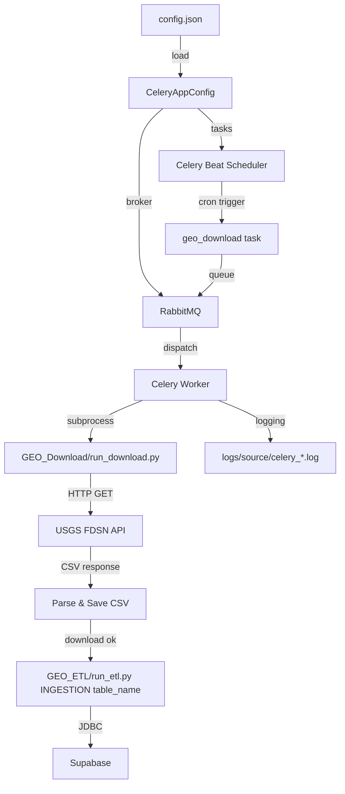

# GEO_E2E

GIS Data End-to-End Pipeline — a Celery-based task scheduler that orchestrates automated geospatial data downloads from the [GEO_Download](../GEO_Download) project and the follow-up ingestion into Supabase via the [GEO_ETL](../GEO_ETL) project.

## Overview

GEO_E2E is the orchestration layer in the GIS data pipeline. It does **not** download or transform data itself — instead, it schedules and monitors jobs by spawning subprocesses that first execute `GEO_Download/run_download.py` and, once the download succeeds, then execute `GEO_ETL/run_etl.py INGESTION <table_name>` for the matching table.

The system requires two always-on processes:
1. **Celery Beat** — a scheduler that sends tasks to RabbitMQ at configured cron-like intervals.
2. **Celery Worker** — a process that picks up tasks from the queue and executes the download + ingestion subprocesses.

RabbitMQ acts as the message broker between them, ensuring tasks are queued reliably even if the worker is temporarily offline.

## Features

- **Cron-like scheduling** — define per-source download schedules with month, day, hour, minute, and timezone.
- **Timezone-aware** — schedule times are specified in local timezone (e.g. `Europe/Warsaw`) and converted to UTC automatically.
- **Chained ingestion** — right after a download succeeds, the matching GEO_ETL ingestion job runs in the same Celery task; it is skipped when the download fails or when no `table_name` is configured for the source.
- **Subprocess execution** — each step runs as an isolated subprocess, capturing stdout/stderr for logging.
- **Structured logging** — each job produces a timestamped log file under `logs/<source>/`.
- **Memory monitoring** — logs system, worker, and subprocess memory usage (`xxx out of yyy GiB (zzz %) used`) at task start and finish.
- **Beat cleanup** — automatically removes stale Celery Beat schedule files on startup to prevent corruption.
- **Frozen Pydantic models** — all configuration objects are immutable.

## Workflow



## Tech Stack

| Component        | Technology                                  |
|------------------|---------------------------------------------|
| Language         | Python 3.11                                 |
| Task Queue       | Celery >= 5.3.0                             |
| Message Broker   | RabbitMQ                                    |
| Data Validation  | Pydantic >= 2.0.0                           |
| HTTP Client      | requests >= 2.31.0 (used by GEO_Download)  |
| Timezone         | pytz >= 2023.3                              |
| Memory Monitor   | psutil >= 5.9.0                             |
| Testing          | pytest >= 7.0.0                             |
| Environment      | Conda                                       |
| Cluster          | Docker Compose (RabbitMQ + Spark 3.5.5)     |

## Project Structure

```
GEO_E2E/
├── docker-compose.yaml   # RabbitMQ + Spark cluster services
├── .env                  # Machine-specific paths (not in git)
├── app.py                # Celery app definition, beat schedule, geo_download task
├── config.json           # Celery config (broker, tasks) and job config (target script)
├── model.py              # Pydantic models: CeleryAppConfig, CeleryTask, JobConfig
├── util.py               # Logger setup, timezone conversion, beat cleanup
├── environment.yml       # Conda environment definition
├── logs/                 # Timestamped log files per source
│   └── USGS_Earthquake/
└── test/                 # Unit tests
    ├── __init__.py
    ├── test_app.py
    ├── test_models.py
    └── test_util.py
```

## Prerequisites

- **Conda** — for environment management
- **RabbitMQ** — running locally on port 5672 (default) or via Docker Compose
- **Docker** — for running RabbitMQ and the Spark cluster (optional but recommended)
- **GEO_Download** — must be a sibling directory (i.e. `../GEO_Download/`) with the `geo_download_311` conda env created, since downloads run there
- **GEO_ETL** — must be a sibling directory (i.e. `../GEO_ETL/`) with the `geo_etl_311` conda env created, since chained ingestion runs there
- **Spark cluster** — must be up (`docker compose up -d geo_spark_master geo_spark_worker_1 geo_spark_worker_2`) before ingestion jobs can connect

## Setup

### 1. Create the Conda environments

This project's own environment:

```bash
conda env create -f environment.yml
```

The download and ingestion steps each run in their own env (see `job.*.conda_env` in `config.json`), so create those too if they don't exist yet:

```bash
conda env create -f ../GEO_Download/environment.yml   # geo_download_311
conda env create -f ../GEO_ETL/environment.yml        # geo_etl_311
```

### 2. Configure environment variables

Copy or edit the `.env` file in this directory. It defines the path to the data folder shared between Docker containers:

```
GEO_DATA_DIR=/absolute/path/to/GEO_Download/data
```

> **Important:** The `.env` file contains machine-specific paths and is excluded from git (listed in `.gitignore`). Each developer must configure it locally.

### 3. Start services with Docker Compose

```bash
docker compose up -d
```

This starts:

| Service | Container | Ports | Purpose |
|---------|-----------|-------|---------|
| RabbitMQ | `geo_rabbitmq` | 5673, 15673 | Message broker for Celery |
| Spark Master | `geo_spark_master` | 7078, 8083 | Spark cluster master |
| Spark Worker 1 | `geo_spark_worker_1` | 8084 | Spark worker (2 cores, 2g RAM) |
| Spark Worker 2 | `geo_spark_worker_2` | 8085 | Spark worker (2 cores, 2g RAM) |

**Spark Web UI:** http://localhost:8083
**RabbitMQ Management UI:** http://localhost:15673 (user: `geo_mq_admin`, pass: `geo_mq_admin`)

### 4. Verify directory structure

All three projects must be siblings under the same parent directory (`GeographicData/`). Both GEO_E2E and GEO_ETL expect GEO_Download to be located at `../GEO_Download/`:

```
GeographicData/
├── GEO_Download/           # Data downloader
│   ├── run_download.py
│   ├── config.json
│   ├── downloader/
│   ├── model/
│   ├── data/               # Downloaded CSV files
│   └── ...
├── GEO_E2E/                # This project (orchestrator + Docker Compose)
│   ├── docker-compose.yaml
│   ├── .env                # Machine-specific paths (not in git)
│   ├── app.py
│   ├── config.json
│   ├── model.py
│   ├── util.py
│   ├── environment.yml
│   └── ...
└── GEO_ETL/                # PySpark ETL cluster
    ├── environment.yml
    ├── run_pyspark_csv_test.py
    └── spark/
        ├── Dockerfile
        └── jars/
```

## Configuration

All settings are in `config.json`:

```json
{
  "celery_app": {
    "name": "geo_download_app",
    "username": "mq_admin",
    "password": "mq_admin",
    "host": "localhost",
    "port": 5672,
    "celery_settings": {
      "task_time_limit": 1800,
      "task_soft_time_limit": 1500
    },
    "tasks": [
      {
        "source_name": "USGS_Earthquake",
        "table_name": "usgs_earthquake",
        "month": "*",
        "day": "*",
        "hour": 2,
        "minute": 0,
        "timezone": "Europe/Warsaw",
        "name": "download_USGS_Earthquake"
      }
    ]
  },
  "job": {
    "download": {
      "folder_name": "GEO_Download",
      "python_script": "run_download.py",
      "conda_env": "geo_download_311"
    },
    "ingestion": {
      "folder_name": "GEO_ETL",
      "python_script": "run_etl.py",
      "conda_env": "geo_etl_311"
    }
  }
}
```

### Celery App Config

| Field      | Description                                              |
|------------|----------------------------------------------------------|
| `name`     | Celery application name                                  |
| `username` | RabbitMQ username                                         |
| `password` | RabbitMQ password                                         |
| `host`     | RabbitMQ host                                            |
| `port`     | RabbitMQ port (default: 5672)                            |
| `tasks`    | List of scheduled download tasks                         |

### Task Config

| Field         | Description                                                   |
|---------------|---------------------------------------------------------------|
| `source_name` | Must match a source key in GEO_Download's `config.json`       |
| `table_name`  | GEO_ETL table to ingest into after a successful download (e.g. `usgs_earthquake`); omit to skip ingestion for this source |
| `month`       | Cron month (`*` = every month, `1`-`12`)                      |
| `day`         | Cron day of month (`*` = every day, `1`-`31`)                 |
| `hour`        | Hour in local timezone (converted to UTC automatically)        |
| `minute`      | Minute (`0`-`59`)                                             |
| `timezone`    | IANA timezone string (e.g. `Europe/Warsaw`, `UTC`)            |
| `name`        | Unique task name for Celery Beat                               |

### Job Config

Two job blocks — `download` runs first, `ingestion` runs only if the download succeeded:

| Block        | `folder_name`  | `python_script` | `conda_env`       |
|--------------|----------------|-----------------|-------------------|
| `download`   | `GEO_Download` | `run_download.py` | `geo_download_311` |
| `ingestion`  | `GEO_ETL`      | `run_etl.py`    | `geo_etl_311`     |

| Field           | Description                                                        |
|-----------------|--------------------------------------------------------------------|
| `folder_name`   | Name of the sibling project directory                              |
| `python_script` | Python script to execute (e.g. `run_download.py`)                  |
| `conda_env`     | Optional. Conda env to run in (`conda run --no-capture-output -n <env>`); each step runs in its own env, so the worker's env does not need PySpark or the downloader's dependencies |

Source → table mapping:

| Source | Table | Source | Table |
|--------|-------|--------|-------|
| `Avalanche_ORG` | `avalanche_org` | `NIFC` | `nifc_fire` |
| `EONET` | `eonet_event` | `OpenMeteo_Flood` | `openmeteo_flood` |
| `GDACS` | `gdacs_event` | `USGS_Earthquake` | `usgs_earthquake` |
| `IBTrACS` | `ibtracs_cyclone` | `USGS_NWIS` | `usgs_nwis` |
| `USGS_Volcano` | `usgs_volcano` | | |

## Usage

### Start the Celery worker and beat scheduler

Both processes must run simultaneously in **separate terminals**. The worker executes tasks; the beat sends them on schedule.

**Terminal 1 — Worker** (executes downloads):

```bash
conda run -n geo_e2e_311 celery -A app.geo_app worker --loglevel=info --concurrency=2
```

> `--concurrency=2` limits the worker to 2 simultaneous pipelines (default is # of CPU cores). Combined with `worker_max_memory_per_child` and `task_time_limit` configured in `config.json`, this prevents memory exhaustion from piled-up jobs.

**Terminal 2 — Beat** (sends tasks on schedule):

```bash
conda run -n geo_e2e_311 celery -A app.geo_app beat --loglevel=info
```

Or run both in one command (worker in background, beat in foreground):

```bash
conda run -n geo_e2e_311 bash -c "celery -A app.geo_app worker --loglevel=info --concurrency=2 & celery -A app.geo_app beat --loglevel=info"
```

> **Important:** Always start the worker **before** the beat, or at the same time. If the beat fires with no worker online, the task will be queued in RabbitMQ and executed once a worker connects.

### How it works

1. Celery Beat triggers `geo_download` task at the configured schedule (converted to UTC automatically).
2. The worker picks up the task from the RabbitMQ queue.
3. The task builds a shell command: `cd ../GEO_Download; conda run --no-capture-output -n geo_download_311 python run_download.py <source_name>`.
4. A subprocess executes the command, with output streamed directly to the log file (no in-memory buffering).
5. Output is logged to `logs/<source>/celery_<source>_<timestamp>.log`.
6. If the download exits with a non-zero return code (likely nothing to download), a warning is logged and **ingestion is skipped**.
7. Otherwise the task runs the chained ingestion command: `cd ../GEO_ETL; conda run --no-capture-output -n geo_etl_311 python run_etl.py INGESTION <table_name>` — output goes to the **same** log file. Sources without a `table_name` skip this step.
8. If ingestion exits non-zero (likely no new files to upload), a warning is logged.
9. If a job hangs, it is killed after 30 minutes (`task_time_limit` in `config.json`) — the limit covers the download **and** the ingestion combined.

### Modifying the schedule

Edit `config.json` — change `hour` and `minute` in the task config. The schedule uses your local timezone (e.g. `Europe/Warsaw`), converted to UTC automatically. Restart the beat process after changes.

```json
{
  "tasks": [
    {
      "source_name": "USGS_Earthquake",
      "hour": 2,
      "minute": 0,
      "timezone": "Europe/Warsaw"
    }
  ]
}
```

### Example log output

```
2026-09-14 02:00:01 INFO ---- Celery triggered download for USGS_Earthquake ----
2026-09-14 02:00:01 INFO Worker Memory: 3.25 out of 15.54 GiB (20.91 %) used
2026-09-14 02:00:01 INFO Running command: cd ..;cd GEO_Download;conda run --no-capture-output -n geo_download_311 python run_download.py USGS_Earthquake
2026-09-14 02:00:15 INFO Download completed successfully for USGS_Earthquake
2026-09-14 02:00:15 INFO Subprocess Memory: 3.31 out of 15.54 GiB (21.30 %) used
2026-09-14 02:00:15 INFO ---- Celery triggered ingestion for USGS_Earthquake -> usgs_earthquake ----
2026-09-14 02:00:15 INFO Running command: cd ..;cd GEO_ETL;conda run --no-capture-output -n geo_etl_311 python run_etl.py INGESTION usgs_earthquake
2026-09-14 02:01:03 INFO Ingestion completed successfully for usgs_earthquake
2026-09-14 02:01:03 INFO Subprocess Memory: 4.12 out of 15.54 GiB (26.52 %) used
2026-09-14 02:01:03 INFO Worker Memory: 4.12 out of 15.54 GiB (26.52 %) used
```

## Testing

```bash
conda run -n geo_e2e_311 pytest test/
```

Tests cover:
- **Models** — `CeleryTask`, `CeleryAppConfig`, `JobTypeConfig`, `JobConfig` creation and method behavior
- **Config loading** — `from_config()` and `get_job_config()` with mock JSON files
- **Broker string** — RabbitMQ connection string generation
- **Command pattern** — subprocess command construction (each step runs via `conda run --no-capture-output` in its configured env)
- **Task chaining** — `geo_download` runs ingestion after a successful download, skips it on download failure or when no `table_name` is set
- **Memory logging** — `get_memory_info()` and `log_memory_usage()` output format and correctness

## Related Projects

- **GEO_Download** — the actual data downloader that GEO_E2E schedules. Handles HTTP requests, CSV parsing, and file storage with historical/incremental modes.
- **GEO_ETL** — PySpark ETL cluster for transforming the downloaded CSV data. Connects to the Spark cluster via `spark://localhost:7078`.
