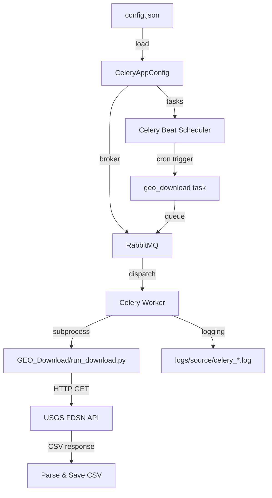

# GEO_E2E

GIS Data End-to-End Pipeline — a Celery-based task scheduler that orchestrates automated geospatial data downloads from the [GEO_Download](../GEO_Download) project.

## Overview

GEO_E2E is the orchestration layer in the GIS data pipeline. It does **not** download data itself — instead, it schedules and monitors download jobs by spawning subprocesses that execute `GEO_Download/run_download.py`.

The system requires two always-on processes:
1. **Celery Beat** — a scheduler that sends tasks to RabbitMQ at configured cron-like intervals.
2. **Celery Worker** — a process that picks up tasks from the queue and executes the actual download subprocess.

RabbitMQ acts as the message broker between them, ensuring tasks are queued reliably even if the worker is temporarily offline.

## Features

- **Cron-like scheduling** — define per-source download schedules with month, day, hour, minute, and timezone.
- **Timezone-aware** — schedule times are specified in local timezone (e.g. `Europe/Warsaw`) and converted to UTC automatically.
- **Subprocess execution** — each download runs as an isolated subprocess, capturing stdout/stderr for logging.
- **Structured logging** — each download job produces a timestamped log file under `logs/<source>/`.
- **Beat cleanup** — automatically removes stale Celery Beat schedule files on startup to prevent corruption.
- **Frozen Pydantic models** — all configuration objects are immutable.

## Workflow



## Tech Stack

| Component        | Technology                                  |
|------------------|---------------------------------------------|
| Language         | Python 3.11                                 |
| Task Queue       | Celery >= 5.3.0                             |
| Message Broker   | RabbitMQ                                    |
| Data Validation  | Pydantic >= 2.0.0                           |
| HTTP Client      | requests >= 2.31.0 (used by GEO_Download)  |
| Timezone         | pytz >= 2023.3                              |
| Testing          | pytest >= 7.0.0                             |
| Environment      | Conda                                       |

## Project Structure

```
GEO_E2E/
├── app.py              # Celery app definition, beat schedule, geo_download task
├── config.json         # Celery config (broker, tasks) and job config (target script)
├── model.py            # Pydantic models: CeleryAppConfig, CeleryTask, JobConfig
├── util.py             # Logger setup, timezone conversion, beat cleanup
├── environment.yml     # Conda environment definition
├── logs/               # Timestamped log files per source
│   └── USGS_Earthquake/
└── test/               # Unit tests
    ├── __init__.py
    ├── test_models.py
    └── test_util.py
```

## Prerequisites

- **Conda** — for environment management
- **RabbitMQ** — running locally on port 5672 (default) or configured in `config.json`
- **GEO_Download** — must be a sibling directory to GEO_E2E (i.e. `../GEO_Download/`)

## Setup

### 1. Create the Conda environment

```bash
conda env create -f environment.yml
```

### 2. Start RabbitMQ

```bash
# macOS (Homebrew)
brew services start rabbitmq

# Linux (systemd)
sudo systemctl start rabbitmq-server

# Docker
docker run -d --name rabbitmq -p 5672:5672 rabbitmq:3
```

### 3. Verify directory structure

GEO_E2E expects GEO_Download to be located at `../GEO_Download/`:

```
GeographicData/
├── GEO_Download/       # Data downloader (sibling)
│   ├── run_download.py
│   └── ...
└── GEO_E2E/            # This project (orchestrator)
    ├── app.py
    └── ...
```

## Configuration

All settings are in `config.json`:

```json
{
  "celery_app": {
    "name": "geo_download_app",
    "username": "mq_admin",
    "password": "mq_admin",
    "host": "localhost",
    "port": 5672,
    "tasks": [
      {
        "source_name": "USGS_Earthquake",
        "month": "*",
        "day": "*",
        "hour": 2,
        "minute": 0,
        "timezone": "Europe/Warsaw",
        "name": "download_USGS_Earthquake"
      }
    ]
  },
  "job": {
    "folder_name": "GEO_Download",
    "python_script": "run_download.py"
  }
}
```

### Celery App Config

| Field      | Description                                              |
|------------|----------------------------------------------------------|
| `name`     | Celery application name                                  |
| `username` | RabbitMQ username                                         |
| `password` | RabbitMQ password                                         |
| `host`     | RabbitMQ host                                            |
| `port`     | RabbitMQ port (default: 5672)                            |
| `tasks`    | List of scheduled download tasks                         |

### Task Config

| Field         | Description                                                   |
|---------------|---------------------------------------------------------------|
| `source_name` | Must match a source key in GEO_Download's `config.json`       |
| `month`       | Cron month (`*` = every month, `1`-`12`)                      |
| `day`         | Cron day of month (`*` = every day, `1`-`31`)                 |
| `hour`        | Hour in local timezone (converted to UTC automatically)        |
| `minute`      | Minute (`0`-`59`)                                             |
| `timezone`    | IANA timezone string (e.g. `Europe/Warsaw`, `UTC`)            |
| `name`        | Unique task name for Celery Beat                               |

### Job Config

| Field           | Description                                                  |
|-----------------|--------------------------------------------------------------|
| `folder_name`   | Name of the GEO_Download directory (sibling folder)          |
| `python_script` | Python script to execute (e.g. `run_download.py`)            |

## Usage

### Start the Celery worker and beat scheduler

Both processes must run simultaneously in **separate terminals**. The worker executes tasks; the beat sends them on schedule.

**Terminal 1 — Worker** (executes downloads):

```bash
conda run -n geo_e2e_311 celery -A app.geo_app worker --loglevel=info --concurrency=2
```

> `--concurrency=2` limits the worker to 2 simultaneous download processes (default is # of CPU cores). Combined with `worker_max_memory_per_child` and `task_time_limit` configured in `app.py`, this prevents memory exhaustion from piled-up downloads.

**Terminal 2 — Beat** (sends tasks on schedule):

```bash
conda run -n geo_e2e_311 celery -A app.geo_app beat --loglevel=info
```

Or run both in one command (worker in background, beat in foreground):

```bash
conda run -n geo_e2e_311 bash -c "celery -A app.geo_app worker --loglevel=info --concurrency=2 & celery -A app.geo_app beat --loglevel=info"
```

> **Important:** Always start the worker **before** the beat, or at the same time. If the beat fires with no worker online, the task will be queued in RabbitMQ and executed once a worker connects.

### How it works

1. Celery Beat triggers `geo_download` task at the configured schedule (converted to UTC automatically).
2. The worker picks up the task from the RabbitMQ queue.
3. The task builds a shell command: `cd ../GEO_Download; python run_download.py <source_name>`.
4. A subprocess executes the command, with output streamed directly to the log file (no in-memory buffering).
5. Output is logged to `logs/<source>/celery_<source>_<timestamp>.log`.
6. On failure, the task raises `CalledProcessError` and logs the error.
7. If a download hangs, it is killed after 10 minutes (`task_time_limit` in `app.py`).

### Modifying the schedule

Edit `config.json` — change `hour` and `minute` in the task config. The schedule uses your local timezone (e.g. `Europe/Warsaw`), converted to UTC automatically. Restart the beat process after changes.

```json
{
  "tasks": [
    {
      "source_name": "USGS_Earthquake",
      "hour": 2,
      "minute": 0,
      "timezone": "Europe/Warsaw"
    }
  ]
}
```

### Example log output

```
2026-09-14 02:00:01 INFO ---- Celery triggered download for USGS_Earthquake ----
2026-09-14 02:00:01 INFO Running command: cd ..;cd GEO_Download;python run_download.py USGS_Earthquake
2026-09-14 02:00:15 INFO Download completed successfully for USGS_Earthquake
```

## Testing

```bash
conda run -n geo_e2e_311 pytest test/
```

Tests cover:
- **Models** — `CeleryTask`, `CeleryAppConfig`, `JobConfig` creation and method behavior
- **Config loading** — `from_config()` and `get_job_config()` with mock JSON files
- **Broker string** — RabbitMQ connection string generation
- **Command pattern** — subprocess command construction

## Related Projects

- **GEO_Download** — the actual data downloader that GEO_E2E schedules. Handles HTTP requests, CSV parsing, and file storage with historical/incremental modes.
