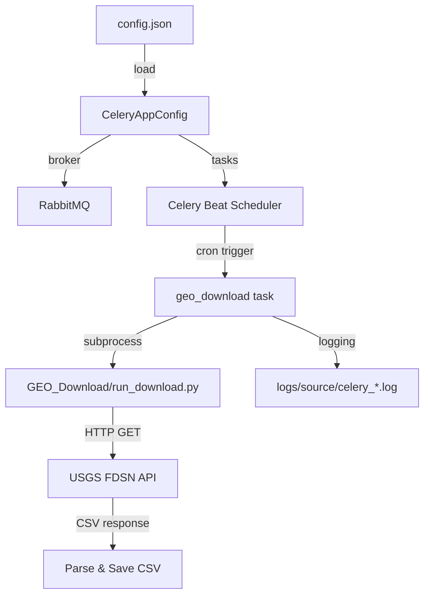

# GEO_E2E

GIS Data End-to-End Pipeline — a Celery-based task scheduler that orchestrates automated geospatial data downloads from the [GEO_Download](../GEO_Download) project.

## Overview

GEO_E2E is the orchestration layer in the GIS data pipeline. It runs as a Celery Beat scheduler with RabbitMQ as the message broker, triggering automated data downloads at configured schedules. Each task spawns a subprocess to execute `GEO_Download/run_download.py`, which handles the actual HTTP fetching and CSV storage.

The application is designed to work alongside GEO_Download — it does not download data itself, but rather schedules and monitors the download jobs.

## Features

- **Cron-like scheduling** — define per-source download schedules with month, day, hour, minute, and timezone.
- **Timezone-aware** — automatically converts local schedule times to UTC for Celery Beat.
- **Subprocess execution** — spawns isolated download processes, capturing stdout/stderr for logging.
- **Structured logging** — each download job produces a timestamped log file under `logs/<source>/`.
- **Beat cleanup** — automatically removes stale Celery Beat schedule files on startup.
- **Frozen Pydantic models** — all configuration objects are immutable.

## Workflow



## Tech Stack

| Component        | Technology                                  |
|------------------|---------------------------------------------|
| Language         | Python 3.11                                 |
| Task Queue       | Celery >= 5.3.0                             |
| Message Broker   | RabbitMQ                                    |
| Data Validation  | Pydantic >= 2.0.0                           |
| HTTP Client      | requests >= 2.31.0 (used by GEO_Download)  |
| Timezone         | pytz >= 2023.3                              |
| Testing          | pytest >= 7.0.0                             |
| Environment      | Conda                                       |

## Project Structure

```
GEO_E2E/
├── app.py              # Celery app definition, beat schedule, geo_download task
├── config.json         # Celery config (broker, tasks) and job config (target script)
├── model.py            # Pydantic models: CeleryAppConfig, CeleryTask, JobConfig
├── util.py             # Logger setup, timezone conversion, beat cleanup
├── environment.yml     # Conda environment definition
├── logs/               # Timestamped log files per source
│   └── USGS_Earthquake/
└── test/               # Unit tests
    ├── __init__.py
    ├── test_models.py
    └── test_util.py
```

## Prerequisites

- **Conda** — for environment management
- **RabbitMQ** — running locally on port 5672 (default) or configured in `config.json`
- **GEO_Download** — must be a sibling directory to GEO_E2E (i.e. `../GEO_Download/`)

## Setup

### 1. Create and activate the Conda environment

```bash
conda env create -f environment.yml
conda activate geo_e2e_311
```

### 2. Start RabbitMQ

```bash
# macOS (Homebrew)
brew services start rabbitmq

# Linux (systemd)
sudo systemctl start rabbitmq-server

# Docker
docker run -d --name rabbitmq -p 5672:5672 rabbitmq:3
```

### 3. Verify directory structure

GEO_E2E expects GEO_Download to be located at `../GEO_Download/`:

```
GeographicData/
├── GEO_Download/       # Data downloader (sibling)
│   ├── run_download.py
│   └── ...
└── GEO_E2E/            # This project (orchestrator)
    ├── app.py
    └── ...
```

## Configuration

All settings are in `config.json`:

```json
{
  "celery_app": {
    "name": "geo_download_app",
    "username": "mq_admin",
    "password": "mq_admin",
    "host": "localhost",
    "port": 5672,
    "tasks": [
      {
        "source_name": "USGS_Earthquake",
        "month": "*",
        "day": "*",
        "hour": 2,
        "minute": 0,
        "timezone": "Europe/Warsaw",
        "name": "download_USGS_Earthquake"
      }
    ]
  },
  "job": {
    "folder_name": "GEO_Download",
    "python_script": "run_download.py"
  }
}
```

### Celery App Config

| Field      | Description                                              |
|------------|----------------------------------------------------------|
| `name`     | Celery application name                                  |
| `username` | RabbitMQ username                                         |
| `password` | RabbitMQ password                                         |
| `host`     | RabbitMQ host                                            |
| `port`     | RabbitMQ port (default: 5672)                            |
| `tasks`    | List of scheduled download tasks                         |

### Task Config

| Field         | Description                                                   |
|---------------|---------------------------------------------------------------|
| `source_name` | Must match a source key in GEO_Download's `config.json`       |
| `month`       | Cron month (`*` = every month, `1`-`12`)                      |
| `day`         | Cron day of month (`*` = every day, `1`-`31`)                 |
| `hour`        | Hour in local timezone (converted to UTC automatically)        |
| `minute`      | Minute (`0`-`59`)                                             |
| `timezone`    | IANA timezone string (e.g. `Europe/Warsaw`, `UTC`)            |
| `name`        | Unique task name for Celery Beat                               |

### Job Config

| Field           | Description                                                  |
|-----------------|--------------------------------------------------------------|
| `folder_name`   | Name of the GEO_Download directory (sibling folder)          |
| `python_script` | Python script to execute (e.g. `run_download.py`)            |

## Usage

### Start the Celery worker and beat scheduler

```bash
celery -A app.geo_app worker --loglevel=info &
celery -A app.geo_app beat --loglevel=info &
```

Or run beat in foreground for debugging:

```bash
celery -A app.geo_app beat --loglevel=debug
```

### How it works

1. Celery Beat triggers `geo_download` task at the configured schedule.
2. The task builds a shell command: `cd ../GEO_Download; python run_download.py <source_name>`.
3. A subprocess executes the command, capturing stdout and stderr.
4. Output is logged to `logs/<source>/celery_<source>_<timestamp>.log`.
5. On failure, the task raises `CalledProcessError` and logs the error.

### Example log output

```
2026-09-14 02:00:01 INFO ---- Celery triggered download for USGS_Earthquake ----
2026-09-14 02:00:01 INFO Running command: cd ..;cd GEO_Download;python run_download.py USGS_Earthquake
2026-09-14 02:00:15 INFO Download completed successfully for USGS_Earthquake
```

## Testing

```bash
pytest test/
```

Tests cover:
- **Models** — `CeleryTask`, `CeleryAppConfig`, `JobConfig` creation and method behavior
- **Config loading** — `from_config()` and `get_job_config()` with mock JSON files
- **Broker string** — RabbitMQ connection string generation
- **Command pattern** — subprocess command construction

## Related Projects

- **GEO_Download** — the actual data downloader that GEO_E2E schedules. Handles HTTP requests, CSV parsing, and file storage with historical/incremental modes.
