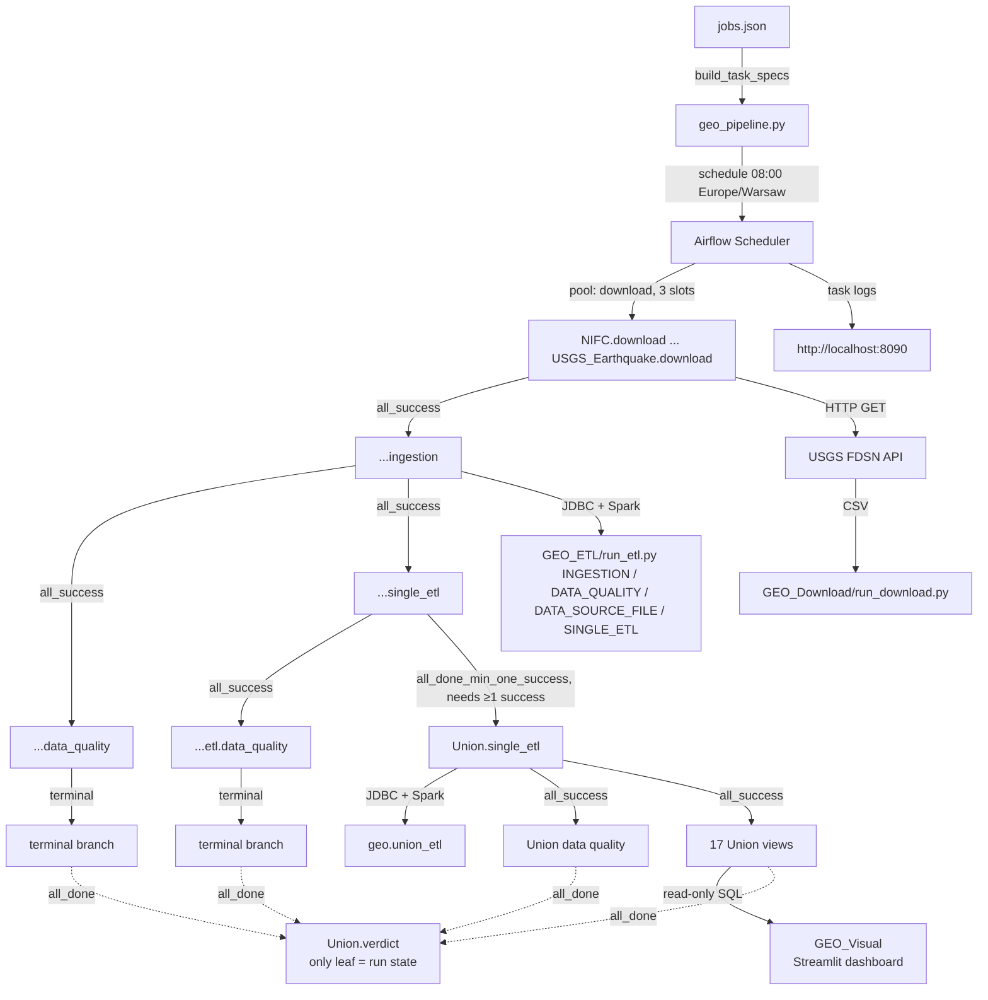

# GEO_E2E

GIS Data End-to-End Pipeline — an Apache Airflow-based orchestrator that runs automated geospatial data downloads from the [GEO_Download](../GEO_Download) project and the follow-up ingestion into Supabase via the [GEO_ETL](../GEO_ETL) project, all visible in the Airflow web UI.

## Overview

GEO_E2E is the orchestration layer in the GIS data pipeline. It does **not** download or transform data itself — instead, it defines one Airflow DAG (`geo_pipeline`) whose tasks spawn subprocesses that first execute `GEO_Download/run_download.py` and, once the download succeeds, then execute `GEO_ETL/run_etl.py INGESTION <table_name>` for the matching table, chained with `GEO_ETL/run_etl.py DATA_QUALITY <table_name>` to record per-`file_date` quality metrics in `geo.data_quality` (each run also refreshes that table's whole-table `overall` snapshot, so the pipelines need no separate `--overall` jobs), `GEO_ETL/run_etl.py SINGLE_ETL <table_name>_etl` to build the analytics-ready `_etl` table from the plain table, and a second `DATA_QUALITY <table_name>_etl` run to measure that etl table. The same download also releases `GEO_ETL/run_etl.py DATA_SOURCE_FILE <source_name>`, which publishes that source's CSV inventory to `geo.data_source_files`.

A tenth job fans the sources back in: the `union_etl` task runs `GEO_ETL/run_etl.py SINGLE_ETL union_etl` to stack all nine `*_etl` tables into `geo.union_etl`. It waits for the `<source>.single_etl` task of **every** source — the nine `*_etl` producers — with Airflow's `all_done_min_one_success` trigger rule, so it starts as soon as the last single-ETL reached a terminal state, whatever the chains' results — but only if at least one of them succeeded (with zero successes the scheduler marks it `upstream_failed` without running it). The union chain then runs `DATA_QUALITY union_etl` to measure the freshly stacked table. Every DATA_QUALITY and DATA_SOURCE_FILE job is a terminal step of `jobs.json` — no job chains from it (like in the old Celery chains); only the verdict gate described below waits on it.

Seventeen `VIEW` jobs hang off that same `union_etl` task — siblings of the union data-quality step, running in parallel with it: each runs `GEO_ETL/run_etl.py VIEW <view_name>` to (re)create one view over `geo.union_etl` (the `metrics_*_vw` and `phenomenons_*_vw` views of GEO_ETL), so the views always reflect the newest stack. They are terminal steps too — no job runs after them; the verdict gate waits on all of them.

One task decides how the run itself is rated: the synthesized **verdict task** (`Union.verdict`) waits for every other task of the DAG (`all_done`) and reads `Union.single_etl`'s state of the run through the Airflow task SDK — it exits 0 only when the stack finished `success`. Airflow derives a run's success/failure from its *leaf* tasks, and the verdict is the DAG's only leaf (every other task waits for it), so the run is green iff the union stack succeeded: a failed download or source single-ETL still fails the run (the union root gets `upstream_failed`), while a failed `DATA_QUALITY`, `DATA_SOURCE_FILE` or `VIEW` task shows red as a task without turning the run red.

Each data source's jobs live in the flat `jobs.json` registry (one object per job; `next_jobs` references the dependent jobs by `name`, same pattern as E2EReddit). `model.build_task_specs()` validates the registry and resolves it into Airflow task specs, which `geo_dag.GEO_DAG` groups into ten code-level subDAGs — one `geo_dag.JobsSubDAG` per source chain plus the union chain — and renders into `BashOperator`s of the single mega-DAG (`geo_pipeline.py` is only its `@dag` wrapper), so dependencies are expressed as a real DAG instead of in-process recursion: a failed task skips its downstream jobs (`all_success` trigger rule), and a failure is visible as red/skipped in the Airflow UI (the old Celery setup reported the task SUCCESS even when the chain failed).

The system runs as four Docker images:

1. **`geo_airflow_spark`** — the Airflow scheduler, API server/UI and DAG processor, plus the Spark standalone master and two workers. It contains Anaconda with the `geo_e2e_311`, `geo_download_311` and `geo_etl_311` environments and the runtime files of GEO_E2E, GEO_Download and GEO_ETL.
2. **`geo_fastapi`** — GEO_API served by uvicorn, with Anaconda and the `geo_api_311` environment.
3. **`geo_react_app`** — the compiled React dashboard served by nginx.
4. **`geo_streamlit`** — GEO_Visual served by Streamlit, with Anaconda and the `geo_visual_311` environment. It reads dashboard views directly from Supabase (read-only SQL), not through GEO_API.

The images are self-contained: no host conda or host source bind mounts. The only host bind mount is the `GEO_Download/data` folder (see [Data, logs and volumes](#6-data-logs-and-volumes)), which keeps downloaded CSVs visible on the host and shared by Airflow and Spark. GEO_API reads the CSV inventory from Supabase (`geo.data_source_files`), which GEO_ETL publishes from the Spark side, so the API container does not mount the data folder. Airflow's metadata lives in the **Supabase** Postgres database — the `geo_airflow` schema of the project configured in `.env` (no local database container); concurrency is capped by two Airflow pools (`download` = 3 slots, `etl` = 2 slots). There is no message broker.

## Features

- **Dependency-driven sequencing** — DOWNLOAD → (INGESTION → (DATA_QUALITY, SINGLE_ETL → DATA_QUALITY), DATA_SOURCE_FILE) is expressed as DAG dependencies; no marker files, no polling.
- **Web UI monitoring** — live grid/gantt/log view of every job at http://localhost:8090; failures show up as red tasks instead of hidden log warnings.
- **Union fan-in with `all_done_min_one_success`** — the union job waits for all nine `<source>.single_etl` tasks to reach a terminal state (whatever their results) and runs only if at least one succeeded; no deadline fallback needed, and the DATA_QUALITY / DATA_SOURCE_FILE jobs stay terminal (no job chains from them).
- **Views after the stack** — the seventeen `VIEW` jobs wait for the `Union.single_etl` task with `all_success` and refresh the `metrics_*_vw` / `phenomenons_*_vw` views on the freshly stacked table.
- **Union-only run state** — the synthesized `Union.verdict` leaf task waits for the whole DAG (`all_done`), reads `Union.single_etl`'s state and exits non-zero unless it succeeded — the run is rated by the union result alone, not by every one of the 74 tasks.
- **Failure gating** — a failed task skips everything chained below it (`all_success` trigger rule = the old `is_stop_if_error` semantics), siblings unaffected.
- **Pools** — at most 3 concurrent downloads and 2 concurrent ETL/Spark jobs.
- **Timeouts, no retries** — every task is killed after 30 minutes (old `task_time_limit`) and never retried.
- **Subprocess execution** — each step runs as an isolated `conda run` subprocess, captured in the Airflow task log.
- **Memory monitoring** — logs system memory usage (`xxx out of yyy GiB (zzz %) used`) at task success and failure.
- **Frozen Pydantic models** — all configuration objects are immutable.

## Workflow



## Tech Stack

| Component        | Technology                                       |
|------------------|--------------------------------------------------|
| Language         | Python 3.11                                      |
| Orchestrator     | Apache Airflow 3.3.2 (LocalExecutor)             |
| Web UI           | Airflow API server on http://localhost:8090      |
| Metadata DB      | Supabase Postgres (`geo_airflow` schema)         |
| Data Validation  | Pydantic >= 2.0.0                                |
| Memory Monitor   | psutil >= 5.9.0                                  |
| Testing          | pytest >= 7.0.0 (local development only)         |
| Linting/Format   | ruff >= 0.6 (local development only)             |
| Check runner     | tox >= 4.0 (local development only)              |
| Type checking    | mypy >= 1.10 (local development only)            |
| Environment      | Anaconda + conda (`geo_*_311` envs in the image) |
| Cluster          | Docker Compose: Airflow + Spark 3.5.5            |
| Frontend         | React 18 + Vite, served by nginx on port 3000    |

## Documentation

| Document | Contents |
|----------|----------|
| [Architecture](docs/architecture.md) | Project layout, DAG generation and failure handling. |
| [Configuration](docs/configuration.md) | `config.json` and `jobs.json` reference — command templates, chains, DAG settings, source → table mapping, and how to construct the DAG (placing jobs, dependencies, union fan-in); plus the Supabase metadata DB and a step-by-step `.env` walkthrough. |
| [Usage](docs/usage.md) | Starting the Airflow stack, the web UI, manual triggers, log locations and example output. |
| [Development](docs/development.md) | Running the tests, Ruff lint/format, mypy and tox environments. |

## Prerequisites

- **Docker Engine 24+ and Docker Compose v2** — the whole stack runs in containers.
- **A Supabase project** — its PostgreSQL credentials are used by Airflow's metadata DB, GEO_ETL, GEO_API and the GEO_Visual dashboard.
- **At least 16 GB RAM on the host** — the default container limits total about 14 GB; use the tuning block in `.env.example` on smaller machines. The first Anaconda build is the other memory peak.
- **No host conda, host project paths or sibling conda environments are required for the Dockerized run.**
- Host conda + Node.js are only needed for the optional local development workflow below.

## Dockerizing the solution (recommended)

### 1. Configure credentials — mandatory before `docker compose up`

Create the git-ignored `.env` from the template:

```bash
cp .env.example .env
```

Then fill in the five **Supabase** values:

```env
SUPABASE_DB_USER=postgres.<project-ref>
SUPABASE_DB_PASSWORD=<supabase_db_password>
SUPABASE_DB_HOST=<pooler host>
SUPABASE_DB_PORT=6543
SUPABASE_DB_NAME=postgres
```

Airflow has usable defaults and does **not** need to be configured unless you want a different login:

```env
_AIRFLOW_WWW_USER_USERNAME=airflow_admin
_AIRFLOW_WWW_USER_PASSWORD=airflow_admin
```

`./setup.sh` can also generate `.env` and imports existing Supabase credentials from `../GEO_ETL/.env`, `../GEO_API/.env` or `../GEO_Visual/.env` when present. Manual `cp .env.example .env` remains the simplest path for a fresh Docker-only checkout. On macOS use `./setup.command`; on Windows use `.\setup.ps1`.

> **Security:** the Supabase credentials are injected into the containers at **runtime** from the Compose `environment:` section. Every long-running Airflow service (scheduler, API server, DAG processor) refreshes its own in-image `.env` through `airflow-entrypoint.sh`; `airflow-init` does the same before the migration, the FastAPI entrypoint writes `GEO_API/.env`, and the Streamlit entrypoint writes `GEO_Visual/.env`. No credential is ever baked into an image layer. `.env` is git-ignored.

`docker compose` loads `.env` automatically from this directory. It fails before starting with a message naming any missing required Supabase variable.

Where the values come from:

1. `SUPABASE_DB_USER`, `SUPABASE_DB_HOST`, `SUPABASE_DB_PORT`, `SUPABASE_DB_NAME` — [Supabase dashboard](https://supabase.com/dashboard) → project → **Connect** → *Connection pooling* → **Transaction pooler**.
2. `SUPABASE_DB_PASSWORD` — the password saved at project creation, or **Project Settings → Database → Generate password** (rotation invalidates the old one immediately).
3. `AIRFLOW_DB_SCHEMA` — leave `geo_airflow`; `airflow-init` creates it before the migration.
4. `VITE_API_BASE` — optional; the API URL compiled into the React app. Keep `http://localhost:8000` when the browser runs on the Docker host.

Full walkthrough and URL anatomy: [Configuration → Supabase metadata DB](docs/configuration.md#supabase-metadata-db-env).

### 2. Build and start the stack

```bash
./build-images.sh      # serial builds; safer on a laptop
docker compose up -d
```

`docker compose up -d --build` works too, but builds independent images in parallel and
can spike RAM on the first run. The first build is long because Anaconda and the
`geo_*_311` environments are installed into the images; later rebuilds reuse the Docker
layer cache.

| Service | Ports | Purpose |
|---------|-------|---------|
| `airflow-init` | – | One-shot: refresh `.env`, create the Supabase schema, migrate the metadata DB, create the admin user, seed pools |
| `airflow-dag-processor` | – | Parses `geo_pipeline.py` into tasks |
| `airflow-scheduler` | – | Triggers the DAG and runs its tasks (LocalExecutor); waits for Spark |
| `airflow-api-server` | **8090** | Airflow REST API + web UI |
| `airflow-dag-activate` | – | One-shot: ensures `geo_pipeline` is unpaused after startup |
| `geo-spark-master` | **7078**, **8083** | Spark master RPC + web UI |
| `geo-spark-worker-1` | **8084** | Spark worker (2 cores, 2g advertised, 3g container limit) |
| `geo-spark-worker-2` | **8085** | Spark worker (2 cores, 2g advertised, 3g container limit) |
| `geo_fastapi` | **8000** | GEO_API (Swagger UI at `/docs`) |
| `geo_react_app` | **3000** | React dashboard served by nginx |
| `geo_streamlit` | **8501** | GEO_Visual Streamlit dashboard |

**Airflow UI:** http://localhost:8090 — default login `airflow_admin` / `airflow_admin` (from `_AIRFLOW_WWW_USER_*`).
**Spark UI:** http://localhost:8083 — worker UIs at http://localhost:8084 and http://localhost:8085.
**GEO_API:** http://localhost:8000 — health at `/health`, Swagger at `/docs`.
**GEO_APP:** http://localhost:3000.
**GEO_Visual:** http://localhost:8501 — Streamlit dashboard.

If a host port is already in use, override it in `.env` without changing the container port:
`AIRFLOW_HOST_PORT`, `SPARK_MASTER_PORT_HOST`, `SPARK_MASTER_UI_HOST_PORT`,
`SPARK_WORKER_1_UI_HOST_PORT`, `SPARK_WORKER_2_UI_HOST_PORT`, `GEO_API_HOST_PORT`,
`GEO_APP_HOST_PORT`, `GEO_VISUAL_HOST_PORT` (see `.env.example`). Remember to update `VITE_API_BASE` and rebuild
`geo_react_app` when the API host port changes.

### 3. Memory and resource limits

The stack is deliberately bounded so a bad task cannot freeze the host:

| Limit | Default | Why |
|-------|---------|-----|
| `AIRFLOW__CORE__PARALLELISM` | `8` | Airflow's `LocalExecutor` default is **32 worker processes**; the pools only need 3 downloads + 2 ETL jobs at a time |
| `AIRFLOW_SCHEDULER_MEM_LIMIT` | `4g` | The scheduler container also runs every task subprocess and its PySpark driver |
| `AIRFLOW_MEM_LIMIT` / `AIRFLOW_INIT_MEM_LIMIT` | `1g` / `2g` | API server, DAG processor and the one-shot init |
| `SPARK_WORKER_MEM_LIMIT` | `3g` per worker | Worker JVM + one executor JVM |
| `SPARK_DRIVER_MEMORY` / `SPARK_EXECUTOR_MEMORY` | `1g` each | PySpark heap caps written into every ETL `SparkSession` |
| `GEO_API_MEM_LIMIT` / `GEO_APP_MEM_LIMIT` / `GEO_VISUAL_MEM_LIMIT` | `1g` / `128m` / `1g` | FastAPI, nginx and Streamlit |

Every service gets `mem_limit` + `memswap_limit` (equal values, so containers cannot push
the host into swap) and `oom_score_adj: 500`, which makes the kernel kill a container
before the desktop session if the host is still short on memory.

Tune them in `.env` (the defaults are in `.env.example`). For a small laptop:

```env
AIRFLOW_PARALLELISM=4
AIRFLOW_MAX_ACTIVE_TASKS_PER_DAG=4
AIRFLOW_SCHEDULER_MEM_LIMIT=3g
SPARK_WORKER_MEMORY=1g
SPARK_WORKER_MEM_LIMIT=2g
SPARK_DRIVER_MEMORY=512m
SPARK_EXECUTOR_MEMORY=512m
```

**Building safely** — the first build runs Anaconda's dependency solver inside three Anaconda-based images.
`docker compose build` builds independent services in parallel, which can spike RAM. Use:

```bash
./build-images.sh          # builds airflow-init, geo_fastapi, geo_streamlit and geo_react_app serially
```

and avoid running the old stack while building for the first time. Check what is actually
running with `docker stats --no-stream`; stop unused workers with
`docker compose stop geo-spark-worker-2` when you are not running ETL jobs. `docker compose down`
releases all container memory (and `restart: unless-stopped` will otherwise start the
stack again after a reboot). `docker compose build --memory` is ignored by BuildKit, so a
serial build is the supported way to cap the build peak.

> The conda definitions use the `libmamba` solver and `PIP_NO_CACHE_DIR=1`; both reduce the
> build's peak memory and disk churn.

### 4. Images and container dependencies

| Image | Contents | Published ports | Dockerfile |
|-------|----------|-----------------|------------|
| `geo_airflow_spark` | Airflow 3.3.2, Spark 3.5.5, Anaconda + `geo_e2e_311` / `geo_download_311` / `geo_etl_311`, GEO_E2E + GEO_Download + GEO_ETL under `/opt/geo` | 8090, 7078, 8083, 8084, 8085 | `docker/geo_airflow_spark/Dockerfile` |
| `geo_fastapi` | GEO_API under `/opt/geo/GEO_API`, Anaconda + `geo_api_311` | 8000 | `docker/geo_fastapi/Dockerfile` |
| `geo_react_app` | compiled Vite `dist` served by nginx (no source or test tooling) | 3000 | `docker/geo_react_app/Dockerfile` |
| `geo_streamlit` | GEO_Visual under `/opt/geo/GEO_Visual`, Anaconda + `geo_visual_311` | 8501 | `docker/geo_streamlit/Dockerfile` |

Container dependencies:

- `airflow-init`, `airflow-scheduler`, `airflow-dag-processor` and `airflow-api-server` → **Supabase** (metadata DB).
- `airflow-scheduler` → `airflow-init` completed + Spark master healthy + both workers started.
- Spark workers → Spark master.
- Airflow + Spark → the host `GEO_Download/data` folder bind-mounted at `/opt/geo/GEO_Download/data`; Airflow downloads CSV files, Spark executors read them.
- `geo_fastapi` → **Supabase** (read-only queries).
- `geo_react_app` → `geo_fastapi` healthy. The browser then calls the API at `VITE_API_BASE` (default `http://localhost:8000`).
- `geo_streamlit` → **Supabase** dashboard views (read-only). It deliberately does not depend on `geo_fastapi`.

### 5. Rebuilding after repository changes

The images copy the source at build time and use **no source bind mounts**, so every repository change is picked up by a rebuild:

```bash
docker compose build                 # rebuild every image whose inputs changed
docker compose up -d                 # recreate the containers on the new images
```

Or in one command:

```bash
docker compose up -d --build
```

Individual images:

```bash
docker compose build airflow-init   # builds geo_airflow_spark (GEO_E2E/GEO_Download/GEO_ETL)
docker compose build geo_fastapi    # builds geo_fastapi (GEO_API)
docker compose build geo_streamlit  # builds geo_streamlit (GEO_Visual)
docker compose build geo_react_app  # builds geo_react_app (GEO_APP)
docker compose up -d
```

On a memory-constrained laptop use `./build-images.sh` instead — it runs exactly these
four builds serially, keeping only one conda solver alive at a time.

`airflow-init` is the Compose service that owns the shared `geo_airflow_spark` build; the scheduler, API server, DAG processor and Spark services reference the same image.

- `docker compose restart` **does not** rebuild an image; use `build` first.
- `docker compose build --no-cache <service>` forces fresh base-image and package resolution.
- The React API URL is inlined by Vite, so changing `VITE_API_BASE` also requires rebuilding `geo_react_app`.
- Base images are pinned to Airflow 3.3.2, Spark 3.5.5, Anaconda 2024.10-1, Node 20 and nginx 1.27.

### 6. Data, logs and volumes

| Mount | Host path / volume | Purpose |
|-------|--------------------|---------|
| `/opt/geo/GEO_Download/data` | `GEO_DATA_DIR` (`../GEO_Download/data` by default) | downloaded CSV files and reference lookups |
| `airflow_data` | named volume | Airflow logs and runtime data |
| `geo_api_logs` | named volume | per-endpoint API logs |

`GEO_Download/data` is the single source of truth: it is bind-mounted into the Airflow and
Spark containers, so a CSV written by a download task is immediately visible on the host and
to every Spark executor. GEO_ETL's DATA_SOURCE_FILE job publishes the CSV inventory from the Spark
side to `geo.data_source_files`; GEO_API reads that table, so the API container has no data
mount. `./setup.sh` writes the absolute `GEO_DATA_DIR` into `.env`; the
manual `.env.example` uses the relative `../GEO_Download/data`. The old `geo_data` named
volume is no longer used and is left untouched (not deleted); `docker compose down -v`
removes only the remaining named volumes, never the host data folder.

### 7. Pools and schedule are automatic

- `airflow-init` seeds the `download` (3 slots) and `etl` (2 slots) pools on every start.
- `dags_are_paused_at_creation=false` creates `geo_pipeline` unpaused; `airflow-dag-activate` also repairs an already-paused DAG after startup.
- The DAG runs daily at **08:00 Europe/Warsaw**, defined by the scheduled jobs in `jobs.json`.

Verify:

```bash
docker compose run --rm airflow-cli pools list
docker compose run --rm airflow-cli dags list
```

### 8. Local development without Docker (optional)

Host conda is only needed for running the DAG code, tests or tooling outside containers:

```bash
conda env create -f environment.yml
conda env create -f ../GEO_Download/environment.yml   # geo_download_311
conda env create -f ../GEO_ETL/environment.yml        # geo_etl_311
./setup.sh                                            # writes host paths + credentials into .env
```

`GEO_DATA_DIR` and `AIRFLOW_UID` are read by Docker Compose (the data bind mount and the runtime UID); `GEO_ROOT` and `CONDA_ROOT` are used only by local runs. Tests and linting stay local:

```bash
tox
ruff check .
mypy
```

### 9. Project layout

All six projects remain siblings under `GeographicData/`. Their runtime files are copied to `/opt/geo/<project>` inside the images, so the relative `../GEO_*` lookups keep working without host mounts.

```text
GeographicData/
├── GEO_Download/           # Data downloader (runtime files baked into geo_airflow_spark)
│   ├── run_download.py
│   ├── config.json
│   ├── downloader/ model/
│   └── data/               # bind-mounted into Airflow + Spark (GEO_DATA_DIR)
├── GEO_E2E/                # orchestrator + Compose + image definitions
│   ├── docker-compose.yaml
│   ├── .env.example        # Docker credentials template (committed)
│   ├── .env                # local credentials (git-ignored)
│   ├── setup.sh            # host + image-mode bootstrap (GEO_DOCKER=1)
│   ├── build-images.sh     # serial image builds for memory-constrained machines
│   ├── config.json / jobs.json
│   ├── model.py / geo_dag.py / geo_pipeline.py / util.py
│   ├── docker/
│   │   ├── geo_airflow_spark/
│   │   │   ├── Dockerfile
│   │   │   ├── Dockerfile.dockerignore
│   │   │   ├── environment/        # runtime-only conda env definitions
│   │   │   ├── jars/               # PostgreSQL JDBC + spark-monitor
│   │   │   ├── create_schema.py
│   │   │   ├── seed_pools.py
│   │   │   ├── refresh-env.sh
│   │   │   └── airflow-entrypoint.sh
│   │   ├── geo_fastapi/
│   │   │   ├── Dockerfile
│   │   │   ├── environment.yml
│   │   │   └── entrypoint.sh
│   │   ├── geo_react_app/
│   │   │   ├── Dockerfile
│   │   │   └── nginx.conf
│   │   └── geo_streamlit/
│   │       ├── Dockerfile
│   │       ├── environment.yml
│   │       └── entrypoint.sh
│   └── docs/ test/
├── GEO_ETL/                # PySpark ETL (runtime files baked into geo_airflow_spark)
├── GEO_API/                # FastAPI service (runtime files baked into geo_fastapi)
├── GEO_APP/                # React dashboard (compiled into geo_react_app)
└── GEO_Visual/             # Streamlit dashboard (runtime files baked into geo_streamlit)
```

## Usage

Everything runs inside Docker Compose — no local worker/beat processes:

```bash
docker compose up -d --build              # build/rebuild images, start the stack
docker compose ps                         # service health and published ports
docker compose logs -f airflow-scheduler  # follow task execution
docker compose logs -f geo_fastapi        # follow API requests/logs
```

Open **http://localhost:8090** (default `airflow_admin` / `airflow_admin`) to watch the `geo_pipeline` grid, re-run failed tasks (**Clear**), inspect task logs, trigger a run manually (**Trigger DAG**) or pause/unpause the schedule (**Active/Paused** toggle on the **DAGs** page). The DAG is unpaused from the start and the pools are pre-seeded (see [Pools and schedule](#7-pools-and-schedule-are-automatic)) — no post-install clicks required.

The API is at **http://localhost:8000**, the React dashboard at **http://localhost:3000**, and the Streamlit dashboard at **http://localhost:8501**.

After changing a project, rebuild the affected image and recreate its containers:

```bash
docker compose build airflow-init   # or geo_fastapi / geo_react_app
docker compose up -d
```

See [Usage](docs/usage.md) for manual triggers, log locations, rebuilds and example output.

Configuration lives in `config.json` (command templates plus the `dag` block: retries, pools, ...) and `jobs.json` (the flat job registry — each job is either *scheduled*, carrying its own `schedule` cron, or *downstreamed* on its parent) — see [Configuration](docs/configuration.md). Quality checks live in [Development](docs/development.md) (`tox`, `ruff check .`, `mypy`).

## Related Projects

- **GEO_Download** — the actual data downloader that GEO_E2E schedules. Handles HTTP requests, CSV parsing, and file storage with historical/incremental modes.
- **GEO_ETL** — PySpark ETL cluster for transforming the downloaded CSV data. Inside the Docker network it connects to the Spark master via `spark://geo-spark-master:7078` (`SPARK_MASTER_URL`); local runs keep `spark://localhost:7078`.
- **GEO_API** — FastAPI data-sharing layer that serves the finished data (`/data-quality/...`, `/event-counts/...`) from the same Supabase project and serves the PySpark-published CSV inventory through `/data-source-files`. Shares its five `SUPABASE_DB_*` credentials — in Docker they are injected from Compose; locally `./setup.sh` writes `../GEO_API/.env`.
- **GEO_APP** — React dashboard that visualises what GEO_API returns (data quality, data quantity, data source files, event categories and locations). The container serves the compiled app on port 3000 and calls the API at `VITE_API_BASE` (default `http://localhost:8000`).
- **GEO_Visual** — Streamlit dashboard served by the `geo_streamlit` container on port 8501. It reads the finished `geo.*` views directly from Supabase (read-only SQL) and does not depend on GEO_API.
