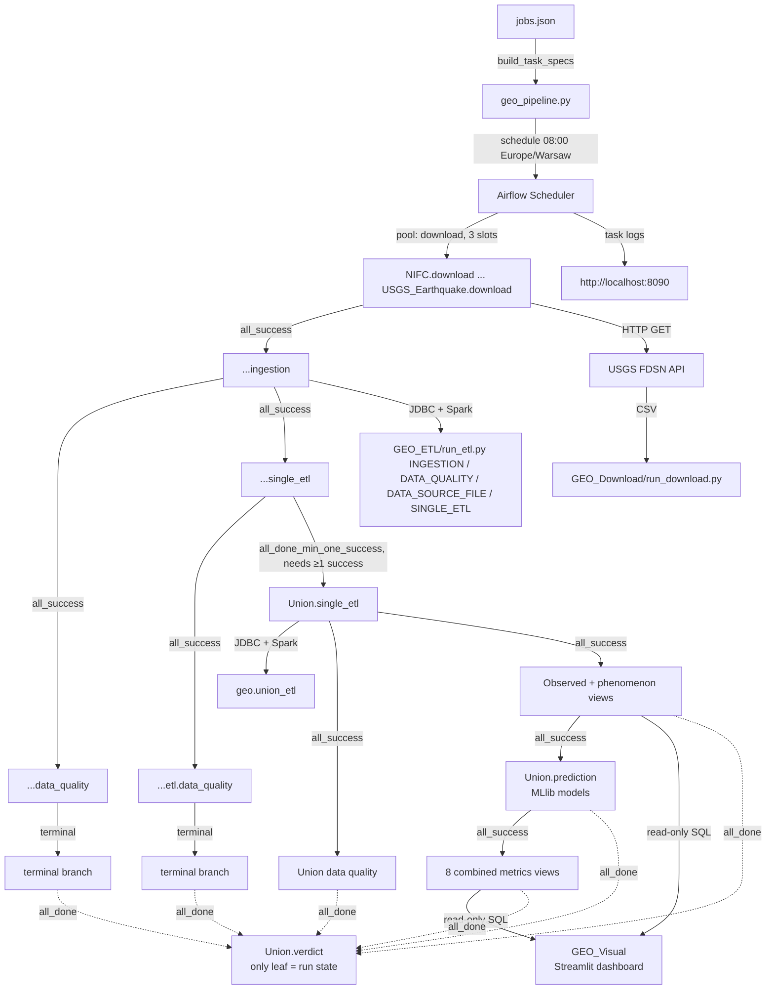

# GEO_E2E

GIS Data End-to-End Pipeline — an Apache Airflow-based orchestrator that runs automated geospatial data downloads from the [GEO_Download](../GEO_Download) project and the follow-up ingestion into Supabase via the [GEO_ETL](../GEO_ETL) project, all visible in the Airflow web UI.

## Overview

GEO_E2E is the orchestration layer in the GIS data pipeline. It does **not** download or transform data itself — instead, it defines one Airflow DAG (`geo_pipeline`) whose tasks spawn subprocesses that first execute `GEO_Download/run_download.py` and, once the download succeeds, then execute `GEO_ETL/run_etl.py INGESTION <table_name>` for the matching table, chained with `GEO_ETL/run_etl.py DATA_QUALITY <table_name>` to record per-`file_date` quality metrics in `geo.data_quality` (each run also refreshes that table's whole-table `overall` snapshot, so the pipelines need no separate `--overall` jobs), `GEO_ETL/run_etl.py SINGLE_ETL <table_name>_etl` to build the analytics-ready `_etl` table from the plain table, and a second `DATA_QUALITY <table_name>_etl` run to measure that etl table. The same download also releases `GEO_ETL/run_etl.py DATA_SOURCE_FILE <source_name>`, which publishes that source's CSV inventory to `geo.data_source_files`.

A tenth job fans the sources back in: the `union_etl` task runs `GEO_ETL/run_etl.py SINGLE_ETL union_etl` to stack all nine `*_etl` tables into `geo.union_etl`. It waits for the `<source>.single_etl` task of **every** source — the nine `*_etl` producers — with Airflow's `all_done_min_one_success` trigger rule, so it starts as soon as the last single-ETL reached a terminal state, whatever the chains' results — but only if at least one of them succeeded (with zero successes the scheduler marks it `upstream_failed` without running it). The union chain then runs `DATA_QUALITY union_etl` to measure the freshly stacked table. Every DATA_QUALITY and DATA_SOURCE_FILE job is a terminal step of `jobs.json` — no job chains from it (like in the old Celery chains); only the verdict gate described below waits on it.

Ten `VIEW` jobs hang off that same `union_etl` task — siblings of the union data-quality step: the shared `metrics_observed_vw` view and the nine `phenomenons_*_vw` map views. Each runs `GEO_ETL/run_etl.py VIEW <view_name>` to (re)create one view over the freshly stacked `geo.union_etl`. The observed view then releases the **`PREDICTION`** job (`run_etl.py PREDICTION prediction_etl`), which trains/reuses PySpark MLlib models and rebuilds `geo.prediction_etl`; the eight combined `metrics_*_vw` views run after it and union the predictions in. The phenomenon/map views do not depend on predictions and keep running in parallel. The metric views are terminal; the verdict gate waits on everything.

One task decides how the run itself is rated: the synthesized **verdict task** (`Union.verdict`) waits for every other task of the DAG (`all_done`) and reads the states of `Union.single_etl` **and** `Union.prediction` through the Airflow task SDK — it exits 0 only when both finished `success`. Airflow derives a run's success/failure from its *leaf* tasks, and the verdict is the DAG's only leaf (every other task waits for it), so the run is green iff the union stack and the prediction refresh succeeded: a failed download or source single-ETL fails the run (the union root gets `upstream_failed`), and so does a failed observed-metrics view or prediction (the metric views would otherwise silently lose their predicted rows). A failed `DATA_QUALITY`, `DATA_SOURCE_FILE`, phenomenon view or combined-metrics view shows red as a task without turning the run red.

Each data source's jobs live in the flat `jobs.json` registry (one object per job; `next_jobs` references the dependent jobs by `name`, same pattern as E2EReddit). `model.build_task_specs()` validates the registry and resolves it into Airflow task specs, which `geo_dag.GEO_DAG` groups into ten code-level subDAGs — one `geo_dag.JobsSubDAG` per source chain plus the union chain — and renders into `BashOperator`s of the single mega-DAG (`geo_pipeline.py` is only its `@dag` wrapper), so dependencies are expressed as a real DAG instead of in-process recursion: a failed task skips its downstream jobs (`all_success` trigger rule), and a failure is visible as red/skipped in the Airflow UI (the old Celery setup reported the task SUCCESS even when the chain failed).

The system runs as four Docker images:

1. **`geo_airflow_spark`** — the Airflow scheduler, API server/UI and DAG processor, plus the Spark standalone master and two workers. It contains Anaconda with the `geo_e2e_311`, `geo_download_311` and `geo_etl_311` environments and the runtime files of GEO_E2E, GEO_Download and GEO_ETL.
2. **`geo_fastapi`** — GEO_API served by uvicorn, with Anaconda and the `geo_api_311` environment.
3. **`geo_react_app`** — the compiled React dashboard served by nginx.
4. **`geo_streamlit`** — GEO_Visual served by Streamlit, with Anaconda and the `geo_visual_311` environment. It reads dashboard views directly from Supabase (read-only SQL), not through GEO_API.

The images are self-contained: no host conda or host source bind mounts. Two host folders are bind-mounted (see [Data, logs and volumes](docs/docker-setup.md#6-data-logs-and-volumes)): `GEO_Download/data`, which keeps downloaded CSVs visible on the host and shared by Airflow and Spark, and `GEO_ETL/ml_models`, which keeps the persisted PySpark MLlib models across image rebuilds. GEO_API reads the CSV inventory from Supabase (`geo.data_source_files`), which GEO_ETL publishes from the Spark side, so the API container does not mount the data folder. Airflow's metadata lives in the **Supabase** Postgres database — the `geo_airflow` schema of the project configured in `.env` (no local database container); concurrency is capped by two Airflow pools (`download` = 3 slots, `etl` = 2 slots). There is no message broker.

## Features

- **Preflight gate before Docker** — `./up.sh` / `./check.sh` verify that all six repositories are present side by side and that `.env` carries the five Supabase credentials; a missing repository or placeholder value stops the stack with an actionable error before any container starts.
- **Dependency-driven sequencing** — DOWNLOAD → (INGESTION → (DATA_QUALITY, SINGLE_ETL → DATA_QUALITY), DATA_SOURCE_FILE) is expressed as DAG dependencies; no marker files, no polling.
- **Web UI monitoring** — live grid/gantt/log view of every job at http://localhost:8090; failures show up as red tasks instead of hidden log warnings.
- **Union fan-in with `all_done_min_one_success`** — the union job waits for all nine `<source>.single_etl` tasks to reach a terminal state (whatever their results) and runs only if at least one succeeded; no deadline fallback needed, and the DATA_QUALITY / DATA_SOURCE_FILE jobs stay terminal (no job chains from them).
- **Views and predictions after the stack** — the eighteen `VIEW` jobs refresh the observed/phenomenon views on the freshly stacked table; the observed view releases `PREDICTION`, and the eight combined `metrics_*_vw` views then run over the refreshed predictions.
- **Union + prediction run state** — the synthesized `Union.verdict` leaf task waits for the whole DAG (`all_done`), reads `Union.single_etl`'s and `Union.prediction`'s states and exits non-zero unless both succeeded — the run is rated by the union stack and prediction refresh, not by every one of the 76 tasks.
- **Failure gating** — a failed task skips everything chained below it (`all_success` trigger rule = the old `is_stop_if_error` semantics), siblings unaffected.
- **Pools** — at most 3 concurrent downloads and 2 concurrent ETL/Spark jobs.
- **Timeouts, no retries** — every task is killed after 30 minutes (old `task_time_limit`) and never retried.
- **Subprocess execution** — each step runs as an isolated `conda run` subprocess, captured in the Airflow task log.
- **Memory monitoring** — logs host memory usage (`xxx out of yyy GiB (zzz %) used`) plus a process/child/cgroup/cache breakdown at task success and failure, so a leak is attributable to a task, the container, ordinary page cache or an unrelated host process.
- **Frozen Pydantic models** — all configuration objects are immutable.

## Workflow



## Tech Stack

| Component        | Technology                                       |
|------------------|--------------------------------------------------|
| Language         | Python 3.11                                      |
| Orchestrator     | Apache Airflow 3.3.2 (LocalExecutor)             |
| ML (GEO_ETL)     | PySpark MLlib (LinearRegression + GBTRegressor)   |
| Web UI           | Airflow API server on http://localhost:8090      |
| Metadata DB      | Supabase Postgres (`geo_airflow` schema)         |
| Data Validation  | Pydantic >= 2.0.0                                |
| Memory Monitor   | psutil >= 5.9.0                                  |
| Testing          | pytest >= 7.0.0 (local development only)         |
| Linting/Format   | ruff >= 0.6 (local development only)             |
| Check runner     | tox >= 4.0 (local development only)              |
| Type checking    | mypy >= 1.10 (local development only)            |
| Environment      | Anaconda + conda (`geo_*_311` envs in the image) |
| Cluster          | Docker Compose: Airflow + Spark 3.5.5            |
| Frontend         | React 18 + Vite, served by nginx on port 3000    |

## Documentation

| Document | Contents |
|----------|----------|
| [Architecture](docs/architecture.md) | Project layout, DAG generation and failure handling. |
| [Configuration](docs/configuration.md) | `config.json` and `jobs.json` reference — command templates, chains, DAG settings, source → table mapping, and how to construct the DAG (placing jobs, dependencies, union fan-in); plus the Supabase metadata DB and a step-by-step `.env` walkthrough. |
| [Usage](docs/usage.md) | Starting the Airflow stack, the web UI, manual triggers, log locations and example output. |
| [Memory leaks investigation 2026-11-23](docs/memory-leaks-investigation-2026-11-23.md) | Seven-day host-memory evidence, desktop-vs-container attribution and the new process/cgroup breakdown. |
| [Memory leaks investigation 2026-11-24](docs/memory-leaks-investigation-2026-11-24.md) | Follow-up after the daily run: desktop growth, flat pipeline containers and the host available/cache diagnostic. |
| [Development](docs/development.md) | Running the tests, Ruff lint/format, mypy and tox environments. |

## Prerequisites

- **All six GEO repositories cloned side by side** — `GEO_API`, `GEO_APP`, `GEO_Download`, `GEO_E2E`, `GEO_ETL` and `GEO_Visual` must share one parent folder (`GeographicData/`). The preflight check refuses to start if any is missing.
- **Python 3 on the host** — used only by the lightweight preflight checker (`preflight.py`, standard library only); the containers do not need a host Python.
- **Docker Engine 24+ and Docker Compose v2** — the whole stack runs in containers.
- **A Supabase project** — its PostgreSQL credentials are used by Airflow's metadata DB, GEO_ETL, GEO_API and the GEO_Visual dashboard.
- **At least 16 GB RAM on the host** — the default container limits total about 14 GB; use the tuning block in `.env.example` on smaller machines. The first Anaconda build is the other memory peak.
- **No host conda, host project paths or sibling conda environments are required for the Dockerized run.**
- Host conda + Node.js are only needed for the optional local development workflow below.

## Docker setup

The supported deployment runs entirely in Docker Compose. The complete walkthrough —
credentials, build/start, resource limits, volumes, pools and local development — is in
[Docker setup](docs/docker-setup.md). The short version is `./check.sh` then `./up.sh -d --build`.

## Usage

Everything runs inside Docker Compose — no local worker/beat processes:

```bash
./up.sh -d --build                       # preflight + build/rebuild + start
docker compose ps                         # service health and published ports
docker compose logs -f airflow-scheduler  # follow task execution
docker compose logs -f geo_fastapi        # follow API requests/logs
```

Open **http://localhost:8090** (default `airflow_admin` / `airflow_admin`) to watch the `geo_pipeline` grid, re-run failed tasks (**Clear**), inspect task logs, trigger a run manually (**Trigger DAG**) or pause/unpause the schedule (**Active/Paused** toggle on the **DAGs** page). The DAG is unpaused from the start and the pools are pre-seeded (see [Pools and schedule](docs/docker-setup.md#7-pools-and-schedule-are-automatic)) — no post-install clicks required.

The API is at **http://localhost:8000**, the React dashboard at **http://localhost:3000**, and the Streamlit dashboard at **http://localhost:8501**.

After changing a project, rebuild the affected image and recreate its containers:

```bash
docker compose build airflow-init   # or geo_fastapi / geo_react_app
./up.sh -d
```

See [Usage](docs/usage.md) for manual triggers, log locations, rebuilds and example output.

Configuration lives in `config.json` (command templates plus the `dag` block: retries, pools, ...) and `jobs.json` (the flat job registry — each job is either *scheduled*, carrying its own `schedule` cron, or *downstreamed* on its parent) — see [Configuration](docs/configuration.md). Quality checks live in [Development](docs/development.md) (`tox`, `ruff check .`, `mypy`).

## Related Projects

- **GEO_Download** — the actual data downloader that GEO_E2E schedules. Handles HTTP requests, CSV parsing, and file storage with historical/incremental modes.
- **GEO_ETL** — PySpark ETL cluster for transforming the downloaded CSV data. Inside the Docker network it connects to the Spark master via `spark://geo-spark-master:7078` (`SPARK_MASTER_URL`); local runs keep `spark://localhost:7078`.
- **GEO_API** — FastAPI data-sharing layer that serves the finished data (`/data-quality/...`, `/event-counts/...`) from the same Supabase project and serves the PySpark-published CSV inventory through `/data-source-files`. Shares its five `SUPABASE_DB_*` credentials — in Docker they are injected from Compose; locally `./setup.sh` writes `../GEO_API/.env`.
- **GEO_APP** — React dashboard that visualises what GEO_API returns (data quality, data quantity, data source files, event categories and locations). The container serves the compiled app on port 3000 and calls the API at `VITE_API_BASE` (default `http://localhost:8000`).
- **GEO_Visual** — Streamlit dashboard served by the `geo_streamlit` container on port 8501. It reads the finished `geo.*` views directly from Supabase (read-only SQL) and does not depend on GEO_API. Its dashboards pair each natural-phenomenon metric timeline with a value distribution histogram, and its Phenomenon maps group contains nine area POI maps (United States, Canada, Central & South America, Europe, Africa, Asia, Australia & Oceania, Russia and international waters) with event date ranges, full-name region cards, structured tooltips, emoji size/text-colour legends and geo-specific projections.
