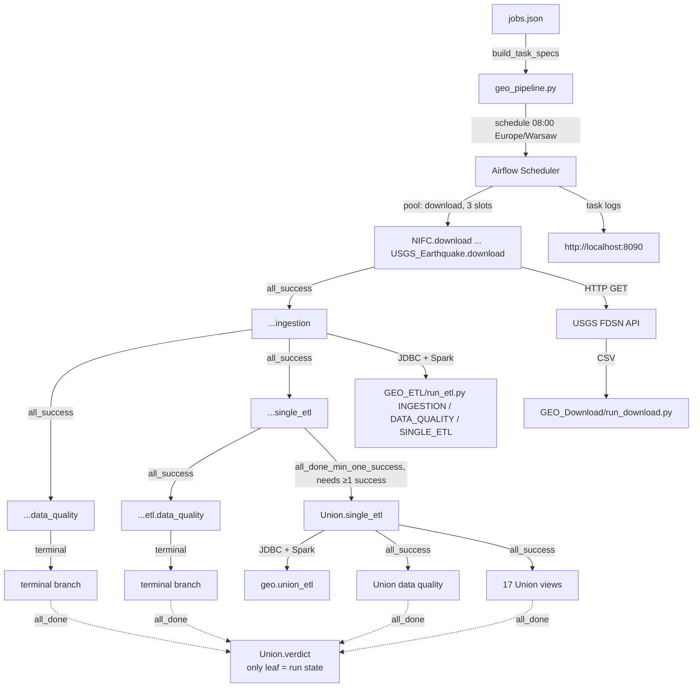

# GEO_E2E

GIS Data End-to-End Pipeline — an Apache Airflow-based orchestrator that runs automated geospatial data downloads from the [GEO_Download](../GEO_Download) project and the follow-up ingestion into Supabase via the [GEO_ETL](../GEO_ETL) project, all visible in the Airflow web UI.

## Overview

GEO_E2E is the orchestration layer in the GIS data pipeline. It does **not** download or transform data itself — instead, it defines one Airflow DAG (`geo_pipeline`) whose tasks spawn subprocesses that first execute `GEO_Download/run_download.py` and, once the download succeeds, then execute `GEO_ETL/run_etl.py INGESTION <table_name>` for the matching table, chained with `GEO_ETL/run_etl.py DATA_QUALITY <table_name>` to record per-`file_date` quality metrics in `geo.data_quality` (each run also refreshes that table's whole-table `overall` snapshot, so the pipelines need no separate `--overall` jobs), `GEO_ETL/run_etl.py SINGLE_ETL <table_name>_etl` to build the analytics-ready `_etl` table from the plain table, and a second `DATA_QUALITY <table_name>_etl` run to measure that etl table.

A tenth job fans the sources back in: the `union_etl` task runs `GEO_ETL/run_etl.py SINGLE_ETL union_etl` to stack all nine `*_etl` tables into `geo.union_etl`. It waits for the `<source>.single_etl` task of **every** source — the nine `*_etl` producers — with Airflow's `all_done_min_one_success` trigger rule, so it starts as soon as the last single-ETL reached a terminal state, whatever the chains' results — but only if at least one of them succeeded (with zero successes the scheduler marks it `upstream_failed` without running it). The union chain then runs `DATA_QUALITY union_etl` to measure the freshly stacked table. Every DATA_QUALITY job is a terminal step of `jobs.json` — no job chains from it (like in the old Celery chains); only the verdict gate described below waits on it.

Seventeen `VIEW` jobs hang off that same `union_etl` task — siblings of the union data-quality step, running in parallel with it: each runs `GEO_ETL/run_etl.py VIEW <view_name>` to (re)create one view over `geo.union_etl` (the `metrics_*_vw` and `phenomenons_*_vw` views of GEO_ETL), so the views always reflect the newest stack. They are terminal steps too — no job runs after them; the verdict gate waits on all of them.

One task decides how the run itself is rated: the synthesized **verdict task** (`Union.verdict`) waits for every other task of the DAG (`all_done`) and reads `Union.single_etl`'s state of the run through the Airflow task SDK — it exits 0 only when the stack finished `success`. Airflow derives a run's success/failure from its *leaf* tasks, and the verdict is the DAG's only leaf (every other task waits for it), so the run is green iff the union stack succeeded: a failed download or source single-ETL still fails the run (the union root gets `upstream_failed`), while a failed `DATA_QUALITY` or `VIEW` task shows red as a task without turning the run red.

Each data source's jobs live in the flat `jobs.json` registry (one object per job; `next_jobs` references the dependent jobs by `name`, same pattern as E2EReddit). `model.build_task_specs()` validates the registry and resolves it into Airflow task specs, which `geo_dag.GEO_DAG` groups into ten code-level subDAGs — one `geo_dag.JobsSubDAG` per source chain plus the union chain — and renders into `BashOperator`s of the single mega-DAG (`geo_pipeline.py` is only its `@dag` wrapper), so dependencies are expressed as a real DAG instead of in-process recursion: a failed task skips its downstream jobs (`all_success` trigger rule), and a failure is visible as red/skipped in the Airflow UI (the old Celery setup reported the task SUCCESS even when the chain failed).

The system runs as Docker Compose services:

1. **Airflow Scheduler** — triggers the `geo_pipeline` DAG daily at 08:00 (Europe/Warsaw) and runs its tasks (LocalExecutor).
2. **Airflow API server + UI** — web UI at http://localhost:8090 (login: `airflow_admin` / `airflow_admin` from `.env.local`) for monitoring, manually triggering and re-running jobs.
3. **Airflow DAG processor** — parses `geo_pipeline.py` into tasks.

PostgreSQL (host port `5472`) stores Airflow's metadata; concurrency is capped by two Airflow pools (`download` = 3 slots, `etl` = 2 slots). There is no message broker.

## Features

- **Dependency-driven sequencing** — DOWNLOAD → INGESTION → (DATA_QUALITY, SINGLE_ETL → DATA_QUALITY) is expressed as DAG dependencies; no marker files, no polling.
- **Web UI monitoring** — live grid/gantt/log view of every job at http://localhost:8090; failures show up as red tasks instead of hidden log warnings.
- **Union fan-in with `all_done_min_one_success`** — the union job waits for all nine `<source>.single_etl` tasks to reach a terminal state (whatever their results) and runs only if at least one succeeded; no deadline fallback needed, and the DATA_QUALITY jobs stay terminal (no job chains from them).
- **Views after the stack** — the seventeen `VIEW` jobs wait for the `Union.single_etl` task with `all_success` and refresh the `metrics_*_vw` / `phenomenons_*_vw` views on the freshly stacked table.
- **Union-only run state** — the synthesized `Union.verdict` leaf task waits for the whole DAG (`all_done`), reads `Union.single_etl`'s state and exits non-zero unless it succeeded — the run is rated by the union result alone, not by every one of the 65 tasks.
- **Failure gating** — a failed task skips everything chained below it (`all_success` trigger rule = the old `is_stop_if_error` semantics), siblings unaffected.
- **Pools** — at most 3 concurrent downloads and 2 concurrent ETL/Spark jobs.
- **Timeouts, no retries** — every task is killed after 30 minutes (old `task_time_limit`) and never retried.
- **Subprocess execution** — each step runs as an isolated `conda run` subprocess, captured in the Airflow task log.
- **Memory monitoring** — logs system memory usage (`xxx out of yyy GiB (zzz %) used`) at task success and failure.
- **Frozen Pydantic models** — all configuration objects are immutable.

## Workflow



## Tech Stack

| Component        | Technology                                    |
|------------------|-----------------------------------------------|
| Language         | Python 3.11                                   |
| Orchestrator     | Apache Airflow 3.3.2 (LocalExecutor)          |
| Web UI           | Airflow API server on http://localhost:8090   |
| Metadata DB      | PostgreSQL 16 (host port 5472)                |
| Data Validation  | Pydantic >= 2.0.0                             |
| Memory Monitor   | psutil >= 5.9.0                               |
| Testing          | pytest >= 7.0.0                               |
| Linting/Format   | ruff >= 0.6 (lint + format + import sort)     |
| Check runner     | tox >= 4.0 (isolated lint/test/typecheck)     |
| Type checking    | mypy >= 1.10 (run via `tox -e typecheck`)     |
| Environment      | Conda                                         |
| Cluster          | Docker Compose (Airflow + Spark 3.5.5)        |

## Documentation

| Document | Contents |
|----------|----------|
| [Architecture](docs/architecture.md) | Project layout, DAG generation and failure handling. |
| [Configuration](docs/configuration.md) | `config.json` and `jobs.json` reference — command templates, chains, DAG settings, source → table mapping, and how to construct the DAG (placing jobs, dependencies, union fan-in). |
| [Usage](docs/usage.md) | Starting the Airflow stack, the web UI, manual triggers, log locations and example output. |
| [Development](docs/development.md) | Running the tests, Ruff lint/format, mypy and tox environments. |

## Prerequisites

- **Conda** — for environment management
- **Docker** — for the Airflow stack and the Spark cluster
- **GEO_Download** — must be a sibling directory (i.e. `../GEO_Download/`) with the `geo_download_311` conda env created, since downloads run there
- **GEO_ETL** — must be a sibling directory (i.e. `../GEO_ETL/`) with the `geo_etl_311` conda env created, since chained ingestion, single-ETL, data-quality and view runs happen there
- **Spark cluster** — must be up (`docker compose --env-file .env.local up -d geo_spark_master geo_spark_worker_1 geo_spark_worker_2`) before ingestion, single-ETL, data-quality and view jobs can connect

## Setup

### 1. Create the Conda environments

This project's own environment (ruff, tox, mypy and the pinned Airflow packages come from the `pip:` section):

```bash
conda env create -f environment.yml
```

For an environment that already exists:

```bash
conda env update -f environment.yml
```

The download and ingestion steps each run in their own env (see `job.*.conda_env` in `config.json` — the data-quality, single-ETL and view steps reuse `geo_etl_311`), so create those too if they don't exist yet:

```bash
conda env create -f ../GEO_Download/environment.yml   # geo_download_311
conda env create -f ../GEO_ETL/environment.yml        # geo_etl_311
```

### 2. Configure environment variables (mandatory)

**Mandatory before the first `docker compose` command** — run the bootstrap script once per checkout; it derives the machine paths from this clone and writes the git-ignored `.env.local`:

```bash
./setup.sh            # --force to regenerate, --help for the flags
```

It prompts for the Airflow UI login (defaults `airflow_admin` / `airflow_admin` when stdin is not a TTY) and echoes the detected `GEO_ROOT`, `CONDA_ROOT` and `AIRFLOW_UID`. Run inside a Docker container it is non-interactive and writes `.env.docker` instead of `.env.local`. On macOS double-click `setup.command` (or run `./setup.command`) — it just runs `setup.sh`; after a ZIP download re-grant the exec bits with `chmod +x setup.command setup.sh`. On Windows run `.\setup.ps1` instead — same detection, same file names (use `powershell -ExecutionPolicy Bypass -File .\setup.ps1` if execution is blocked). Manual fallback: `cp .env.example .env.local` and adjust the six values.

`.env.local` defines the machine-specific paths, uid and the Airflow UI login — **the only place where your real values live** (`.env.local` is git-ignored; the compose file and the rest of the repo contain only variable references, no private paths or credentials). Compose does not auto-load that filename, so every command below carries `--env-file .env.local`:

```
GEO_DATA_DIR=<GEO_ROOT>/GEO_Download/data
GEO_ROOT=<parent dir of the sibling projects>
CONDA_ROOT=<conda base dir, e.g. $(conda info --base)>
AIRFLOW_UID=$(id -u)
_AIRFLOW_WWW_USER_USERNAME=<airflow_username>
_AIRFLOW_WWW_USER_PASSWORD=<airflow_password>
```

> **Important:** `docker compose --env-file .env.local` refuses to start with a clear error when `GEO_ROOT`, `CONDA_ROOT` or the two `_AIRFLOW_WWW_USER_*` credentials are missing — all are required: the sibling projects and conda are bind-mounted **at their host paths** inside the containers so that `conda run -n <env>` (absolute env shebangs) and the `cd ..;cd GEO_*` commands keep resolving, and `airflow-init` creates the web UI admin user from the credentials.

### 3. Start services with Docker Compose

```bash
docker compose --env-file .env.local up -d --build
```

This starts:

| Service | Ports | Purpose |
|---------|-------|---------|
| `airflow-postgres` | 5472 | Airflow metadata database |
| `airflow-init` | – | One-shot: DB migration, admin user creation (exits 0) |
| `airflow-dag-processor` | – | Parses `geo_pipeline.py` |
| `airflow-scheduler` | – | Triggers the DAG and runs its tasks (LocalExecutor) |
| `airflow-api-server` | 8090 | Airflow REST API + web UI |
| Spark Master | 7078, 8083 | Spark cluster master |
| Spark Worker 1 | – | Spark worker (2 cores, 2g RAM); its web UI (8084) is container-internal only |
| Spark Worker 2 | – | Spark worker (2 cores, 2g RAM); its web UI (8085) is container-internal only |

**Airflow UI:** http://localhost:8090 (user: `airflow_admin`, pass: `airflow_admin` — the `_AIRFLOW_WWW_USER_*` values from `.env.local`)
**Spark Web UI:** http://localhost:8083

> The Airflow containers use `network_mode: host`, so task subprocesses reach the Spark master at `spark://localhost:7078` (the address in `../GEO_ETL/config.json`) and your host conda envs via their bind-mounted absolute paths. Postgres stays on the bridge network with host port `5472` — Airflow reaches it at `127.0.0.1:5472`.

### 4. Nothing else to configure — pools and unpausing are automatic

Two one-time UI steps are automated:

- **Pools** — `airflow-init` seeds them on every start (idempotent): `download` = 3 slots, `etl` = 2 slots.
- **Unpausing** — `dags_are_paused_at_creation=false`, so `geo_pipeline` is created **unpaused** on first parse and runs daily at 08:00 (Europe/Warsaw).

Verify in the UI at http://localhost:8090 → **DAGs** (the toggle is on) or via `docker compose --env-file .env.local run --rm airflow-cli pools list` / `dags list`. You can also trigger a run manually via **Trigger DAG**.

### 5. Verify directory structure

All three projects must be siblings under the same parent directory (`GeographicData/`). Both GEO_E2E and GEO_ETL expect GEO_Download to be located at `../GEO_Download/`:

```
GeographicData/
├── GEO_Download/           # Data downloader
│   ├── run_download.py
│   ├── config.json
│   ├── downloader/
│   ├── model/
│   ├── data/               # Downloaded CSV files
│   └── ...
├── GEO_E2E/                # This project (orchestrator + Docker Compose)
│   ├── docker-compose.yaml
│   ├── .env.example        # Template for the machine-specific .env.local (committed)
│   ├── .env.local          # Machine-specific paths (written by ./setup.sh, not in git)
│   ├── setup.sh            # Bootstrap: writes .env.local with this checkout's paths
│   ├── config.json         # Command templates per job type
│   ├── jobs.json           # Job chains per data source
│   ├── model.py            # Config models + build_task_specs()
│   ├── geo_dag.py          # JobsSubDAG + GEO_DAG (task specs -> Airflow DAG)
│   ├── geo_pipeline.py     # The Airflow DAG (geo_pipeline)
│   ├── .airflowignore      # only geo_pipeline.py counts as a DAG file
│   ├── util.py             # Memory logging helpers
│   ├── docker/
│   │   └── airflow/
│   │       └── Dockerfile # Airflow image (providers + psutil + pydantic)
│   ├── environment.yml
│   ├── docs/
│   └── ...
└── GEO_ETL/                # PySpark ETL cluster
    ├── environment.yml
    ├── run_pyspark_csv_test.py
    └── spark_cluster_image/
        ├── Dockerfile
        └── jars/
```

## Usage

Everything runs inside Docker Compose — no local worker/beat processes:

```bash
docker compose --env-file .env.local up -d --build              # build the Airflow image, start the stack
docker compose --env-file .env.local logs -f airflow-scheduler  # follow the scheduler (task execution)
```

Open **http://localhost:8090** (user: `airflow_admin`, pass: `airflow_admin` — the `_AIRFLOW_WWW_USER_*` values from `.env.local`) to watch the `geo_pipeline` grid, re-run failed tasks (**Clear**), inspect task logs, trigger a run manually (**Trigger DAG**) or pause/unpause the schedule (**Active/Paused** toggle on the **DAGs** page). The DAG is unpaused from the start and the pools are pre-seeded (see [Setup](#4-nothing-else-to-configure--pools-and-unpausing-are-automatic)) — no post-install clicks required.

See [Usage](docs/usage.md) for manual triggers, log locations and example output.

Configuration lives in `config.json` (command templates plus the `dag` block: retries, pools, ...) and `jobs.json` (the flat job registry — each job is either *scheduled*, carrying its own `schedule` cron, or *downstreamed* on its parent) — see [Configuration](docs/configuration.md). Quality checks live in [Development](docs/development.md) (`tox`, `ruff check .`, `mypy`).

## Related Projects

- **GEO_Download** — the actual data downloader that GEO_E2E schedules. Handles HTTP requests, CSV parsing, and file storage with historical/incremental modes.
- **GEO_ETL** — PySpark ETL cluster for transforming the downloaded CSV data. Connects to the Spark cluster via `spark://localhost:7078`.
