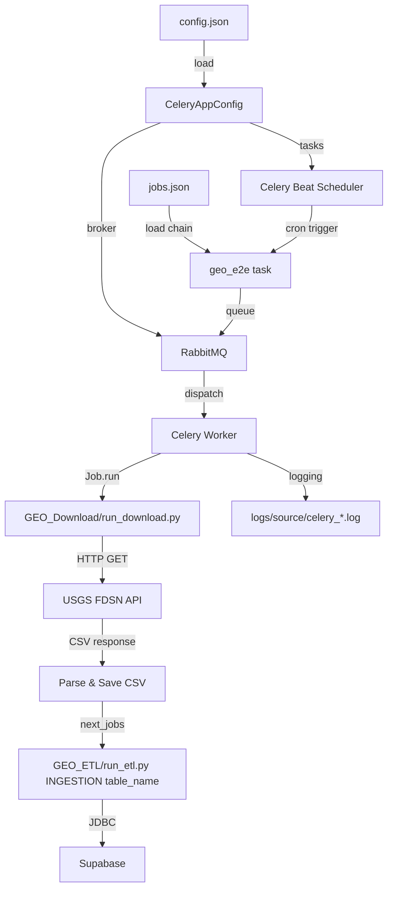

# GEO_E2E

GIS Data End-to-End Pipeline — a Celery-based task scheduler that orchestrates automated geospatial data downloads from the [GEO_Download](../GEO_Download) project and the follow-up ingestion into Supabase via the [GEO_ETL](../GEO_ETL) project.

## Overview

GEO_E2E is the orchestration layer in the GIS data pipeline. It does **not** download or transform data itself — instead, it schedules and monitors jobs by spawning subprocesses that first execute `GEO_Download/run_download.py` and, once the download succeeds, then execute `GEO_ETL/run_etl.py INGESTION <table_name>` for the matching table.

Each data source has its own job chain in `jobs.json` (`job_type` + `next_jobs`, same pattern as E2EReddit). A chain is executed recursively inside a single Celery task, and a chain is followed only while the jobs keep succeeding.

The system requires two always-on processes:
1. **Celery Beat** — a scheduler that sends tasks to RabbitMQ at configured cron-like intervals.
2. **Celery Worker** — a process that picks up tasks from the queue and executes the job chain subprocesses.

RabbitMQ acts as the message broker between them, ensuring tasks are queued reliably even if the worker is temporarily offline.

## Features

- **Cron-like scheduling** — define per-source schedules with month, day, hour, minute, and timezone; tasks are named `geo_e2e_<data_source>`.
- **Timezone-aware** — schedule times are specified in local timezone (e.g. `Europe/Warsaw`) and converted to UTC automatically.
- **Job chains (`next_jobs`)** — each source's chain lives in `jobs.json`; after a job finishes successfully its `next_jobs` run recursively, so DOWNLOAD is followed by INGESTION in the same Celery task. A failing job stops the chain.
- **Subprocess execution** — each step runs as an isolated subprocess, capturing stdout/stderr for logging.
- **Structured logging** — the whole chain writes to one timestamped log file under `logs/<source>/`.
- **Memory monitoring** — logs system, worker, and subprocess memory usage (`xxx out of yyy GiB (zzz %) used`) at task start and finish.
- **Beat cleanup** — automatically removes stale Celery Beat schedule files on startup to prevent corruption.
- **Frozen Pydantic models** — all configuration objects are immutable.

## Workflow



## Tech Stack

| Component        | Technology                                  |
|------------------|---------------------------------------------|
| Language         | Python 3.11                                 |
| Task Queue       | Celery >= 5.3.0                             |
| Message Broker   | RabbitMQ                                    |
| Data Validation  | Pydantic >= 2.0.0                           |
| HTTP Client      | requests >= 2.31.0 (used by GEO_Download)  |
| Timezone         | pytz >= 2023.3                              |
| Memory Monitor   | psutil >= 5.9.0                             |
| Testing          | pytest >= 7.0.0                             |
| Linting/Format   | ruff >= 0.6 (lint + format + import sort)   |
| Check runner     | tox >= 4.0 (isolated lint/test/typecheck)   |
| Type checking    | mypy >= 1.10 (run via `tox -e typecheck`)   |
| Environment      | Conda                                       |
| Cluster          | Docker Compose (RabbitMQ + Spark 3.5.5)     |

## Documentation

| Document | Contents |
|----------|----------|
| [Architecture](docs/architecture.md) | Project layout, the chain execution model and failure handling. |
| [Configuration](docs/configuration.md) | Full `config.json` and `jobs.json` reference — schedules, command templates, chains, source → table mapping. |
| [Usage](docs/usage.md) | Starting the worker/beat, running a chain manually, log locations and example output. |
| [Development](docs/development.md) | Running the tests, Ruff lint/format, mypy and tox environments. |

## Prerequisites

- **Conda** — for environment management
- **RabbitMQ** — reachable at the `celery_app.port` from `config.json` (`5673` with the bundled Docker Compose, which maps host `5673` → container `5672`)
- **Docker** — for running RabbitMQ and the Spark cluster (optional but recommended)
- **GEO_Download** — must be a sibling directory (i.e. `../GEO_Download/`) with the `geo_download_311` conda env created, since downloads run there
- **GEO_ETL** — must be a sibling directory (i.e. `../GEO_ETL/`) with the `geo_etl_311` conda env created, since chained ingestion runs there
- **Spark cluster** — must be up (`docker compose up -d geo_spark_master geo_spark_worker_1 geo_spark_worker_2`) before ingestion jobs can connect

## Setup

### 1. Create the Conda environments

This project's own environment (ruff, tox and mypy come from the `pip:` section):

```bash
conda env create -f environment.yml
```

For an environment that already exists:

```bash
conda env update -f environment.yml
```

The download and ingestion steps each run in their own env (see `job.*.conda_env` in `config.json`), so create those too if they don't exist yet:

```bash
conda env create -f ../GEO_Download/environment.yml   # geo_download_311
conda env create -f ../GEO_ETL/environment.yml        # geo_etl_311
```

### 2. Configure environment variables

Copy or edit the `.env` file in this directory. It defines the path to the data folder shared between Docker containers:

```
GEO_DATA_DIR=/absolute/path/to/GEO_Download/data
```

> **Important:** The `.env` file contains machine-specific paths and is excluded from git (listed in `.gitignore`). Each developer must configure it locally.

### 3. Start services with Docker Compose

```bash
docker compose up -d
```

This starts:

| Service | Container | Ports | Purpose |
|---------|-----------|-------|---------|
| RabbitMQ | `geo_rabbitmq` | 5673, 15673 | Message broker for Celery |
| Spark Master | `geo_spark_master` | 7078, 8083 | Spark cluster master |
| Spark Worker 1 | `geo_spark_worker_1` | 8084 | Spark worker (2 cores, 2g RAM) |
| Spark Worker 2 | `geo_spark_worker_2` | 8085 | Spark worker (2 cores, 2g RAM) |

**Spark Web UI:** http://localhost:8083
**RabbitMQ Management UI:** http://localhost:15673 (user: `geo_mq_admin`, pass: `geo_mq_admin`)

### 4. Verify directory structure

All three projects must be siblings under the same parent directory (`GeographicData/`). Both GEO_E2E and GEO_ETL expect GEO_Download to be located at `../GEO_Download/`:

```
GeographicData/
├── GEO_Download/           # Data downloader
│   ├── run_download.py
│   ├── config.json
│   ├── downloader/
│   ├── model/
│   ├── data/               # Downloaded CSV files
│   └── ...
├── GEO_E2E/                # This project (orchestrator + Docker Compose)
│   ├── docker-compose.yaml
│   ├── .env                # Machine-specific paths (not in git)
│   ├── app.py
│   ├── config.json
│   ├── jobs.json
│   ├── model.py
│   ├── util.py
│   ├── environment.yml
│   ├── docs/
│   └── ...
└── GEO_ETL/                # PySpark ETL cluster
    ├── environment.yml
    ├── run_pyspark_csv_test.py
    └── spark/
        ├── Dockerfile
        └── jars/
```

## Usage

Start the worker and the beat in **separate terminals** (worker first):

```bash
# Terminal 1 — worker (executes the job chains)
conda run -n geo_e2e_311 celery -A app.geo_app worker --loglevel=info --concurrency=2

# Terminal 2 — beat (sends tasks on schedule)
conda run -n geo_e2e_311 celery -A app.geo_app beat --loglevel=info
```

See [Usage](docs/usage.md) for running a single chain manually, log locations and example output.

Configuration lives in `config.json` (schedules and command templates) and `jobs.json` (chains) — see [Configuration](docs/configuration.md). Quality checks live in [Development](docs/development.md) (`tox`, `ruff check .`, `mypy`).

## Related Projects

- **GEO_Download** — the actual data downloader that GEO_E2E schedules. Handles HTTP requests, CSV parsing, and file storage with historical/incremental modes.
- **GEO_ETL** — PySpark ETL cluster for transforming the downloaded CSV data. Connects to the Spark cluster via `spark://localhost:7078`.
