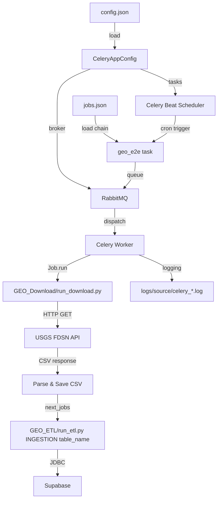

# GEO_E2E

GIS Data End-to-End Pipeline — a Celery-based task scheduler that orchestrates automated geospatial data downloads from the [GEO_Download](../GEO_Download) project and the follow-up ingestion into Supabase via the [GEO_ETL](../GEO_ETL) project.

## Overview

GEO_E2E is the orchestration layer in the GIS data pipeline. It does **not** download or transform data itself — instead, it schedules and monitors jobs by spawning subprocesses that first execute `GEO_Download/run_download.py` and, once the download succeeds, then execute `GEO_ETL/run_etl.py INGESTION <table_name>` for the matching table.

Each data source has its own job chain in `jobs.json` (`job_type` + `next_jobs`, same pattern as E2EReddit). A chain is executed recursively inside a single Celery task, and a chain is followed only while the jobs keep succeeding.

The system requires two always-on processes:
1. **Celery Beat** — a scheduler that sends tasks to RabbitMQ at configured cron-like intervals.
2. **Celery Worker** — a process that picks up tasks from the queue and executes the job chain subprocesses.

RabbitMQ acts as the message broker between them, ensuring tasks are queued reliably even if the worker is temporarily offline.

## Features

- **Cron-like scheduling** — define per-source schedules with month, day, hour, minute, and timezone; tasks are named `geo_e2e_<data_source>`.
- **Timezone-aware** — schedule times are specified in local timezone (e.g. `Europe/Warsaw`) and converted to UTC automatically.
- **Job chains (`next_jobs`)** — each source's chain lives in `jobs.json`; after a job finishes successfully its `next_jobs` run recursively, so DOWNLOAD is followed by INGESTION in the same Celery task. A failing job stops the chain.
- **Subprocess execution** — each step runs as an isolated subprocess, capturing stdout/stderr for logging.
- **Structured logging** — the whole chain writes to one timestamped log file under `logs/<source>/`.
- **Memory monitoring** — logs system, worker, and subprocess memory usage (`xxx out of yyy GiB (zzz %) used`) at task start and finish.
- **Beat cleanup** — automatically removes stale Celery Beat schedule files on startup to prevent corruption.
- **Frozen Pydantic models** — all configuration objects are immutable.

## Workflow



## Tech Stack

| Component        | Technology                                  |
|------------------|---------------------------------------------|
| Language         | Python 3.11                                 |
| Task Queue       | Celery >= 5.3.0                             |
| Message Broker   | RabbitMQ                                    |
| Data Validation  | Pydantic >= 2.0.0                           |
| HTTP Client      | requests >= 2.31.0 (used by GEO_Download)  |
| Timezone         | pytz >= 2023.3                              |
| Memory Monitor   | psutil >= 5.9.0                             |
| Testing          | pytest >= 7.0.0                             |
| Linting/Format   | ruff >= 0.6 (lint + format + import sort)   |
| Check runner     | tox >= 4.0 (isolated lint/test/typecheck)   |
| Type checking    | mypy >= 1.10 (run via `tox -e typecheck`)   |
| Environment      | Conda                                       |
| Cluster          | Docker Compose (RabbitMQ + Spark 3.5.5)     |

## Project Structure

```
GEO_E2E/
├── docker-compose.yaml   # RabbitMQ + Spark cluster services
├── .env                  # Machine-specific paths (not in git)
├── app.py                # Celery app definition, beat schedule, geo_e2e task
├── config.json           # Celery config (broker, tasks) and job config (commands)
├── jobs.json             # Job chains per data source: job_type -> next_jobs
├── model.py              # Pydantic models: CeleryAppConfig, CeleryTask, JobConfig, Job
├── util.py               # Logger setup, timezone conversion, beat cleanup, run_command
├── environment.yml       # Conda environment definition (Python + ruff/tox/mypy)
├── pyproject.toml        # Ruff rules, formatter style and pytest options
├── tox.ini               # lint / test / typecheck / format / warnings environments
├── logs/                 # Timestamped log files per source
│   └── USGS_Earthquake/
└── test/                 # Unit tests
    ├── __init__.py
    ├── test_app.py
    ├── test_jobs.py
    ├── test_models.py
    └── test_util.py
```

## Prerequisites

- **Conda** — for environment management
- **RabbitMQ** — running locally on port 5672 (default) or via Docker Compose
- **Docker** — for running RabbitMQ and the Spark cluster (optional but recommended)
- **GEO_Download** — must be a sibling directory (i.e. `../GEO_Download/`) with the `geo_download_311` conda env created, since downloads run there
- **GEO_ETL** — must be a sibling directory (i.e. `../GEO_ETL/`) with the `geo_etl_311` conda env created, since chained ingestion runs there
- **Spark cluster** — must be up (`docker compose up -d geo_spark_master geo_spark_worker_1 geo_spark_worker_2`) before ingestion jobs can connect

## Setup

### 1. Create the Conda environments

This project's own environment (ruff, tox and mypy come from the `pip:` section):

```bash
conda env create -f environment.yml
```

For an environment that already exists:

```bash
conda env update -f environment.yml
```

The download and ingestion steps each run in their own env (see `job.*.conda_env` in `config.json`), so create those too if they don't exist yet:

```bash
conda env create -f ../GEO_Download/environment.yml   # geo_download_311
conda env create -f ../GEO_ETL/environment.yml        # geo_etl_311
```

### 2. Configure environment variables

Copy or edit the `.env` file in this directory. It defines the path to the data folder shared between Docker containers:

```
GEO_DATA_DIR=/absolute/path/to/GEO_Download/data
```

> **Important:** The `.env` file contains machine-specific paths and is excluded from git (listed in `.gitignore`). Each developer must configure it locally.

### 3. Start services with Docker Compose

```bash
docker compose up -d
```

This starts:

| Service | Container | Ports | Purpose |
|---------|-----------|-------|---------|
| RabbitMQ | `geo_rabbitmq` | 5673, 15673 | Message broker for Celery |
| Spark Master | `geo_spark_master` | 7078, 8083 | Spark cluster master |
| Spark Worker 1 | `geo_spark_worker_1` | 8084 | Spark worker (2 cores, 2g RAM) |
| Spark Worker 2 | `geo_spark_worker_2` | 8085 | Spark worker (2 cores, 2g RAM) |

**Spark Web UI:** http://localhost:8083
**RabbitMQ Management UI:** http://localhost:15673 (user: `geo_mq_admin`, pass: `geo_mq_admin`)

### 4. Verify directory structure

All three projects must be siblings under the same parent directory (`GeographicData/`). Both GEO_E2E and GEO_ETL expect GEO_Download to be located at `../GEO_Download/`:

```
GeographicData/
├── GEO_Download/           # Data downloader
│   ├── run_download.py
│   ├── config.json
│   ├── downloader/
│   ├── model/
│   ├── data/               # Downloaded CSV files
│   └── ...
├── GEO_E2E/                # This project (orchestrator + Docker Compose)
│   ├── docker-compose.yaml
│   ├── .env                # Machine-specific paths (not in git)
│   ├── app.py
│   ├── config.json
│   ├── model.py
│   ├── util.py
│   ├── environment.yml
│   └── ...
└── GEO_ETL/                # PySpark ETL cluster
    ├── environment.yml
    ├── run_pyspark_csv_test.py
    └── spark/
        ├── Dockerfile
        └── jars/
```

## Configuration

All settings are in `config.json`:

```json
{
  "celery_app": {
    "name": "geo_download_app",
    "username": "mq_admin",
    "password": "mq_admin",
    "host": "localhost",
    "port": 5672,
    "celery_settings": {
      "task_time_limit": 1800,
      "task_soft_time_limit": 1500
    },
    "tasks": [
      {
        "source_name": "USGS_Earthquake",
        "month": "*",
        "day": "*",
        "hour": 2,
        "minute": 0,
        "timezone": "Europe/Warsaw",
        "name": "geo_e2e_USGS_Earthquake"
      }
    ]
  },
  "job": {
    "download": {
      "folder_name": "GEO_Download",
      "python_script": "run_download.py",
      "conda_env": "geo_download_311"
    },
    "ingestion": {
      "folder_name": "GEO_ETL",
      "python_script": "run_etl.py",
      "conda_env": "geo_etl_311"
    }
  }
}
```

### Celery App Config

| Field      | Description                                              |
|------------|----------------------------------------------------------|
| `name`     | Celery application name                                  |
| `username` | RabbitMQ username                                         |
| `password` | RabbitMQ password                                         |
| `host`     | RabbitMQ host                                            |
| `port`     | RabbitMQ port (default: 5672)                            |
| `tasks`    | List of scheduled job chains (one entry per data source)      |

### Task Config

| Field         | Description                                                   |
|---------------|---------------------------------------------------------------|
| `source_name` | Must match a source key in `jobs.json` and in GEO_Download's `config.json` |
| `month`       | Cron month (`*` = every month, `1`-`12`)                      |
| `day`         | Cron day of month (`*` = every day, `1`-`31`)                 |
| `hour`        | Hour of day as an integer `0`-`23` in local timezone (converted to UTC automatically; `*` is not supported) |
| `minute`      | Minute (`0`-`59`)                                             |
| `timezone`    | IANA timezone string (e.g. `Europe/Warsaw`, `UTC`)            |
| `name`        | Unique Celery Beat task name, conventionally `geo_e2e_<source_name>` (e.g. `geo_e2e_NIFC`) |

### Job Config

The `job` block defines **how** each job type is executed (command, folder, conda env). It is referenced by every job in a chain:

| Block        | `folder_name`  | `python_script` | `conda_env`       |
|--------------|----------------|-----------------|-------------------|
| `download`   | `GEO_Download` | `run_download.py` | `geo_download_311` |
| `ingestion`  | `GEO_ETL`      | `run_etl.py`    | `geo_etl_311`     |

| Field           | Description                                                        |
|-----------------|--------------------------------------------------------------------|
| `folder_name`   | Name of the sibling project directory                              |
| `python_script` | Python script to execute (e.g. `run_download.py`)                  |
| `conda_env`     | Optional. Conda env to run in (`conda run --no-capture-output -n <env>`); each step runs in its own env, so the worker's env does not need PySpark or the downloader's dependencies |

### Job Chains (`jobs.json`)

The chain for each data source — which jobs run, in what order, and what happens on failure. Keyed by `source_name`, exactly like E2EReddit's `jobs.json`:

```json
{
  "NIFC": {
    "source_name": "NIFC",
    "job_type": "DOWNLOAD",
    "is_failed_if_error": false,
    "next_jobs": [
      {
        "source_name": "NIFC",
        "job_type": "INGESTION",
        "table_name": "nifc_fire",
        "is_failed_if_error": false,
        "next_jobs": []
      }
    ]
  }
}
```

| Field               | Description                                                                 |
|---------------------|-----------------------------------------------------------------------------|
| `source_name`       | Data source this job belongs to (must match the key and `config.json` task) |
| `job_type`          | `DOWNLOAD` or `INGESTION` — selects the matching `job.*` command block      |
| `table_name`        | Required for `INGESTION` — table passed to `run_etl.py INGESTION <table>`   |
| `is_failed_if_error`| `true` → non-zero return code raises `CalledProcessError` (Celery task FAILURE); `false` → warning is logged |
| `next_jobs`         | Jobs to run **after this job succeeded**, recursively (same list shape, nests to any depth) |

> A non-zero return code **stops the chain** in both cases — `next_jobs` never run after a failed job.

Source → table mapping:

| Source | Table | Source | Table |
|--------|-------|--------|-------|
| `Avalanche_ORG` | `avalanche_org` | `NIFC` | `nifc_fire` |
| `EONET` | `eonet_event` | `OpenMeteo_Flood` | `openmeteo_flood` |
| `GDACS` | `gdacs_event` | `USGS_Earthquake` | `usgs_earthquake` |
| `IBTrACS` | `ibtracs_cyclone` | `USGS_NWIS` | `usgs_nwis` |
| `USGS_Volcano` | `usgs_volcano` | | |

## Usage

### Start the Celery worker and beat scheduler

Both processes must run simultaneously in **separate terminals**. The worker executes tasks; the beat sends them on schedule.

**Terminal 1 — Worker** (executes the job chains):

```bash
conda run -n geo_e2e_311 celery -A app.geo_app worker --loglevel=info --concurrency=2
```

> `--concurrency=2` limits the worker to 2 simultaneous pipelines (default is # of CPU cores). Combined with `worker_max_memory_per_child` and `task_time_limit` configured in `config.json`, this prevents memory exhaustion from piled-up jobs.

**Terminal 2 — Beat** (sends tasks on schedule):

```bash
conda run -n geo_e2e_311 celery -A app.geo_app beat --loglevel=info
```

Or run both in one command (worker in background, beat in foreground):

```bash
conda run -n geo_e2e_311 bash -c "celery -A app.geo_app worker --loglevel=info --concurrency=2 & celery -A app.geo_app beat --loglevel=info"
```

> **Important:** Always start the worker **before** the beat, or at the same time. If the beat fires with no worker online, the task will be queued in RabbitMQ and executed once a worker connects.

### How it works

1. Celery Beat triggers the `geo_e2e` task at the configured schedule (converted to UTC automatically); the beat entry is named `geo_e2e_<source_name>`.
2. The worker picks up the task from the RabbitMQ queue and loads the source's chain root from `jobs.json` (`Job.from_config(source_name)`).
3. `Job.run()` builds the shell command for the current `job_type` from the `job` block of `config.json` — for `DOWNLOAD`: `cd ../GEO_Download; conda run --no-capture-output -n geo_download_311 python run_download.py <source_name>`.
4. A subprocess executes the command, with output streamed directly to the log file (no in-memory buffering).
5. Output of the **whole chain** goes to `logs/<source>/celery_<source>_<timestamp>.log`.
6. If the job exits non-zero, the chain **stops** — `next_jobs` are never executed. With `is_failed_if_error: false` a warning is logged; with `true` a `CalledProcessError` is raised and Celery marks the task as FAILURE.
7. If the job succeeded, `Job.run()` recursively runs its `next_jobs` — for `DOWNLOAD` that is `INGESTION`: `cd ../GEO_ETL; conda run --no-capture-output -n geo_etl_311 python run_etl.py INGESTION <table_name>`.
8. The recursion continues to any depth, so extra steps can be appended to `jobs.json` without touching code.
9. If a job hangs, it is killed after 30 minutes (`task_time_limit` in `config.json`) — the limit covers the whole chain.

### Modifying the schedule

Edit `config.json` — change `hour` and `minute` in the task config. The schedule uses your local timezone (e.g. `Europe/Warsaw`), converted to UTC automatically. Restart the beat process after changes.

```json
{
  "tasks": [
    {
      "source_name": "USGS_Earthquake",
      "hour": 2,
      "minute": 0,
      "timezone": "Europe/Warsaw"
    }
  ]
}
```

### Example log output

```
2026-09-14 02:00:01 INFO ---- Celery triggered E2E job chain for USGS_Earthquake ----
2026-09-14 02:00:01 INFO Worker Memory: 3.25 out of 15.54 GiB (20.91 %) used
2026-09-14 02:00:01 INFO Starting DOWNLOAD job for "USGS_Earthquake".
2026-09-14 02:00:01 INFO Executing command: cd ..;cd GEO_Download;conda run --no-capture-output -n geo_download_311 python run_download.py USGS_Earthquake
2026-09-14 02:00:15 INFO Finished DOWNLOAD job for "USGS_Earthquake". Return code: 0.
2026-09-14 02:00:15 INFO Starting INGESTION job for "USGS_Earthquake".
2026-09-14 02:00:15 INFO Executing command: cd ..;cd GEO_ETL;conda run --no-capture-output -n geo_etl_311 python run_etl.py INGESTION usgs_earthquake
2026-09-14 02:01:03 INFO Finished INGESTION job for "USGS_Earthquake". Return code: 0.
2026-09-14 02:01:03 INFO Worker Memory: 4.12 out of 15.54 GiB (26.52 %) used
```

## Testing & Code Quality

### Tests

```bash
conda run -n geo_e2e_311 pytest test/     # options come from pyproject.toml (testpaths = test, -q)
tox -e py311                              # the same suite, in an isolated tox environment
tox -e py311 -- -k jobs                   # filtered run (arguments after -- are passed to pytest)
```

Tests cover:
- **Models** — `CeleryTask`, `CeleryAppConfig`, `JobTypeConfig`, `JobConfig`, `Job`, `EJobType` creation and method behavior
- **Config loading** — `from_config()` and `get_job_config()` with mock JSON files
- **Broker string** — RabbitMQ connection string generation
- **Command pattern** — subprocess command construction (each step runs via `conda run --no-capture-output` in its configured env)
- **Job chains** — `Job.from_config()` loads `jobs.json`, `Job.run()` executes `next_jobs` recursively, stops on failure and raises only when `is_failed_if_error` is set
- **Task wiring** — beat schedule entries named `geo_e2e_<source>` calling `app.geo_e2e`, chain execution and failure handling
- **Memory logging** — `get_memory_info()` and `log_memory_usage()` output format and correctness

### Ruff, mypy and tox

Linting, formatting, type checking and tests are driven by **[Ruff](https://docs.astral.sh/ruff/)**, **[mypy](https://mypy.readthedocs.io/)** and **[tox](https://tox.wiki/)** — the same tooling as GEO_Download. All three are installed from the `pip:` section of `environment.yml`:

```bash
conda env update -f environment.yml   # only needed once if the env already existed
```

| Tool | Role | Where it is configured |
|------|------|------------------------|
| **Ruff** | Linter + formatter + import sorter (replaces flake8 / isort / black) | `pyproject.toml` → `[tool.ruff]`, `[tool.ruff.lint]`, `[tool.ruff.format]` |
| **mypy** | Static type checking of `app.py`, `model.py`, `util.py` | `pyproject.toml` → `[tool.mypy]`, `tox.ini` → `[testenv:typecheck]` |
| **tox** | Runs every check in a throwaway virtualenv with its own dependencies | `tox.ini` |
| **pytest** | Test suite | `pyproject.toml` → `[tool.pytest.ini_options]` |

Direct commands while editing:

```bash
ruff check .                            # lint everything, writes nothing
ruff check --fix .                      # apply safe autofixes (imports, modernization, unused code)
ruff check --output-format=concise .    # one line per finding — good for CI logs
ruff format --check .                   # list files that are not canonically formatted
ruff format .                           # rewrite files in style (line length 120)
mypy                                    # type check (target files come from pyproject.toml)
```

Ruff rules: `line-length = 120`, `target-version = "py311"`; `logs/`, `__pycache__` and `.idea` are excluded. Enabled families: `E,W` (pycodestyle), `F` (pyflakes), `I` (import sorting), `B` (bugbear), `UP` (pyupgrade), `C4` (comprehensions), `SIM` (simplify), `RUF` (ruff-specific), with `SIM108` ignored. Celery has no type stubs, so `celery*` is marked `ignore_missing_imports` in `[tool.mypy.overrides]`.

### tox environments

`tox` with no arguments runs the default `envlist` from `tox.ini` (`lint, py311`):

| Command | What runs | Status |
|---------|-----------|--------|
| `tox` | default gate = `lint` + `py311` | ✅ |
| `tox -e lint` | `ruff check --output-format=concise .` | ✅ 0 findings |
| `tox -e py311` | full pytest suite (40 tests) | ✅ |
| `tox -e typecheck` | `mypy` (`app.py`, `model.py`, `util.py`) | ✅ 0 errors |
| `tox -e format` | `ruff format --check .` | ✅ 9 files already formatted |
| `tox -e warnings` | `pytest -W error::DeprecationWarning` | ✅ |
| `tox -e format-fix` | `ruff format .` — writes the changes | – |
| `tox -e lint,py311,typecheck` | any list of environments in one invocation | – |

Notes:

- tox creates its environments under `.tox/` (git-ignored) and installs each env's `deps` from `tox.ini`; your shell only needs `tox` itself — no conda activation is required.
- `skip_install = true` everywhere — the project is not installed as a package, tests import it from the working directory.
- To add a new check, add a `[testenv:xxx]` block; append `xxx` to `envlist` to make it part of the default `tox` run.

## Related Projects

- **GEO_Download** — the actual data downloader that GEO_E2E schedules. Handles HTTP requests, CSV parsing, and file storage with historical/incremental modes.
- **GEO_ETL** — PySpark ETL cluster for transforming the downloaded CSV data. Connects to the Spark cluster via `spark://localhost:7078`.
